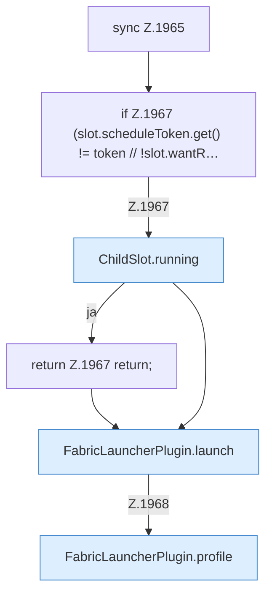

[[00 Start]] › [[Child-Prozess]] › [[Neustart]] › [[FabricLauncherPlugin.restartSingle]] › [[FabricLauncherPlugin.restartSingle.Z1965]]

# FabricLauncherPlugin.restartSingle.Z1965



```knoten
sync Z.1965
  Zeile 1965: synchronisierter Block.
if Z.1967 (slot.scheduleToken.get() != token // !slot.wantR…
  Zeile 1967: prüft `(slot.scheduleToken.get() != token // !slot.wantR…`.
ChildSlot.running
  Dieser Teil prüft, ob läuft, das. Sagt, ob der [[Glossar#Prozess|Prozess]] läuft `running`.
return Z.1967 return;
  Zeile 1967: Rückgabe `return;`.
FabricLauncherPlugin.launch
  Legt Ordner und Dateien an, schreibt die [[Glossar#Lizenz|Lizenz]], startet das Programm und schaltet Mitlesen und [[Glossar#Aufsicht|Aufsicht]] an. Scheitert das, wird aufgeräumt. Startet den [[Glossar#Prozess|Prozess]] `launch`. Ruft `running`, `directory`, `copyPlayerFiles`.
FabricLauncherPlugin.profile
  Das [[Glossar#Plugin|Plugin]] macht hier einen einzelnen Schritt. Eine Ebene tiefer steht er genauer. `profile` in `FabricLauncherPlugin.java`.
```

> [!knoten]- Was die Blöcke tun
> - **sync Z.1965**: Zeile 1965: synchronisierter Block.
> - **if Z.1967 (slot.scheduleToken.get() != token // !slot.wantR…**: Zeile 1967: prüft `(slot.scheduleToken.get() != token // !slot.wantR…`.
> - **ChildSlot.running**: Dieser Teil prüft, ob läuft, das. Sagt, ob der [[Glossar#Prozess|Prozess]] läuft `running`.
> - **return Z.1967 return;**: Zeile 1967: Rückgabe `return;`.
> - **FabricLauncherPlugin.launch**: Legt Ordner und Dateien an, schreibt die [[Glossar#Lizenz|Lizenz]], startet das Programm und schaltet Mitlesen und [[Glossar#Aufsicht|Aufsicht]] an. Scheitert das, wird aufgeräumt. Startet den [[Glossar#Prozess|Prozess]] `launch`. Ruft `running`, `directory`, `copyPlayerFiles`.
> - **FabricLauncherPlugin.profile**: Das [[Glossar#Plugin|Plugin]] macht hier einen einzelnen Schritt. Eine Ebene tiefer steht er genauer. `profile` in `FabricLauncherPlugin.java`.

- Der Ablauf geht in [[Glossar#Zeile|Zeile]] 1965 weiter. Eine Ebene tiefer steht er genauer.
- Fortsetzung von `FabricLauncherPlugin.restartSingle`.
