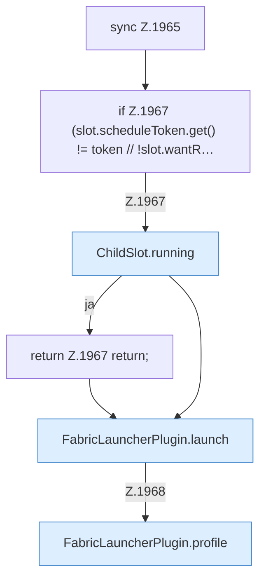

[[00 Start]] › [[Child-Prozess]] › [[Neustart]] › [[FabricLauncherPlugin.restartSingle]] › [[FabricLauncherPlugin.restartSingle.Z1965]]

# FabricLauncherPlugin.restartSingle.Z1965

- Fortsetzung von `FabricLauncherPlugin.restartSingle`, Quellreihenfolge.
