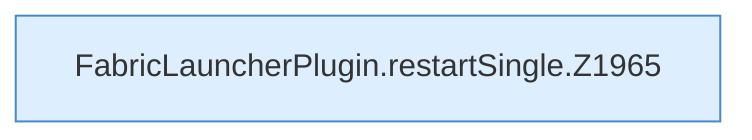

[[00 Start]] › [[Child-Prozess]] › [[Neustart]] › [[FabricLauncherPlugin.restartSingle]]

# FabricLauncherPlugin.restartSingle

`FabricLauncherPlugin.restartSingle(ChildSlot slot, int token)` [src/main/java/de/aichele/childlauncher/FabricLauncherPlugin.java:1965–1970](https://github.com/Sciddie/minecraft-serverhoster-plugin/blob/95b02b953b0b4c23673e900e021a7c3c844aa37d/src/main/java/de/aichele/childlauncher/FabricLauncherPlugin.java#L1965-L1970)



```knoten
FabricLauncherPlugin.restartSingle.Z1965
  Der Ablauf geht in [[Glossar#Zeile|Zeile]] 1965 weiter. Eine Ebene tiefer steht er genauer. Im [[Glossar#Quelltext|Quelltext]] heißt das `Z1965`.
```

> [!knoten]- Was die Blöcke tun
> - **FabricLauncherPlugin.restartSingle.Z1965**: Der Ablauf geht in [[Glossar#Zeile|Zeile]] 1965 weiter. Eine Ebene tiefer steht er genauer. Im [[Glossar#Quelltext|Quelltext]] heißt das `Z1965`.

- Schaltet genau diesen einen [[Glossar#Spielserver|Spielserver]] aus und wieder an.
