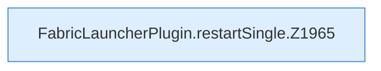

[[00 Start]] › [[Child-Prozess]] › [[Neustart]] › [[FabricLauncherPlugin.restartSingle]]

# FabricLauncherPlugin.restartSingle

`FabricLauncherPlugin.restartSingle(ChildSlot slot, int token)` [src/main/java/de/aichele/childlauncher/FabricLauncherPlugin.java:1965–1970](https://github.com/Sciddie/minecraft-serverhoster-plugin/blob/95b02b953b0b4c23673e900e021a7c3c844aa37d/src/main/java/de/aichele/childlauncher/FabricLauncherPlugin.java#L1965-L1970)

- `restartSingle` in `src/main/java/de/aichele/childlauncher/FabricLauncherPlugin.java`
