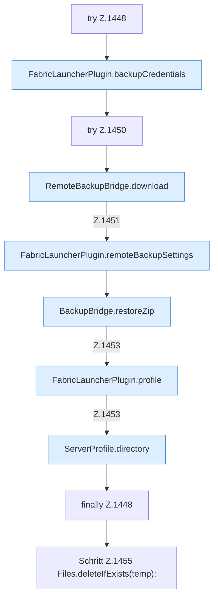

[[00 Start]] › [[Backup]] › [[Backup-Dateien]] › [[FabricLauncherPlugin.restoreBackup]] › [[FabricLauncherPlugin.restoreBackup.Z1446.Z1448]]

# FabricLauncherPlugin.restoreBackup.Z1446.Z1448

- Fortsetzung von `FabricLauncherPlugin.restoreBackup.Z1446`, Quellreihenfolge.
