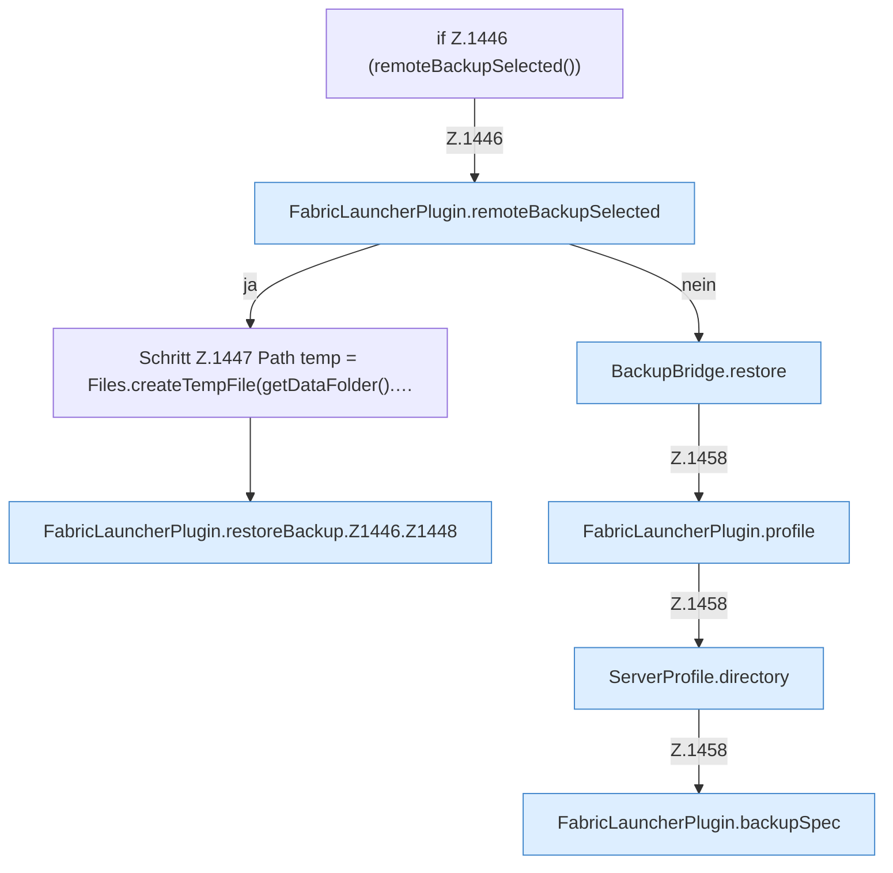

[[00 Start]] › [[Backup]] › [[Backup-Dateien]] › [[FabricLauncherPlugin.restoreBackup]] › [[FabricLauncherPlugin.restoreBackup.Z1446]]

# FabricLauncherPlugin.restoreBackup.Z1446

- Fortsetzung von `FabricLauncherPlugin.restoreBackup`, Quellreihenfolge.
