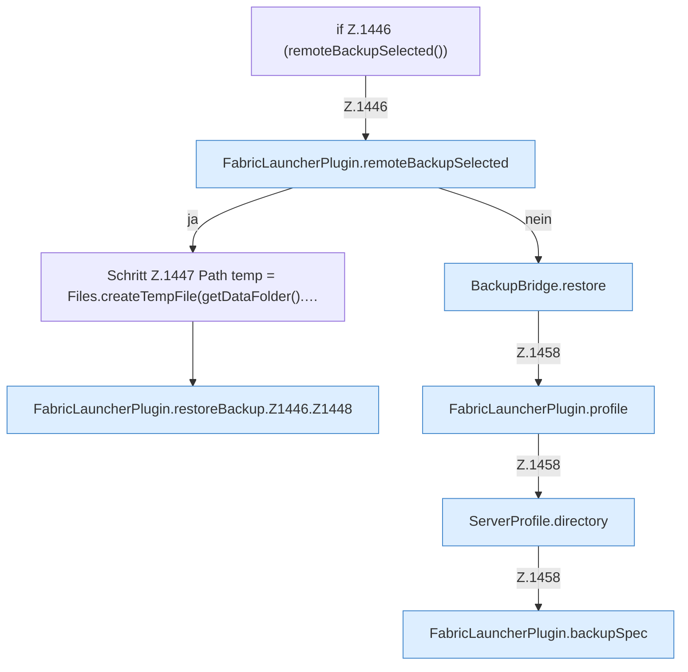

[[00 Start]] › [[Backup]] › [[Backup-Dateien]] › [[FabricLauncherPlugin.restoreBackup]] › [[FabricLauncherPlugin.restoreBackup.Z1446]]

# FabricLauncherPlugin.restoreBackup.Z1446



```knoten
if Z.1446 (remoteBackupSelected())
  Zeile 1446: prüft `(remoteBackupSelected())`.
FabricLauncherPlugin.remoteBackupSelected
  `remoteBackupSelected` in `FabricLauncherPlugin.java`.
Schritt Z.1447 Path temp = Files.createTempFile(getDataFolder().…
  Zeile 1447: Dateioperation. `Path temp = Files.createTempFile(getDataFolder().…`
FabricLauncherPlugin.restoreBackup.Z1446.Z1448
  Fortsetzung des Ablaufs ab Zeile 1448.
BackupBridge.restore
  Stellt wieder her `restore`. Ruft `file`, `restoreZip`.
FabricLauncherPlugin.profile
  `profile` in `FabricLauncherPlugin.java`.
ServerProfile.directory
  `directory` in `ServerProfile.java`.
FabricLauncherPlugin.backupSpec
  Sichert `backupSpec`.
```

- Fortsetzung von `FabricLauncherPlugin.restoreBackup`, Quellreihenfolge.
