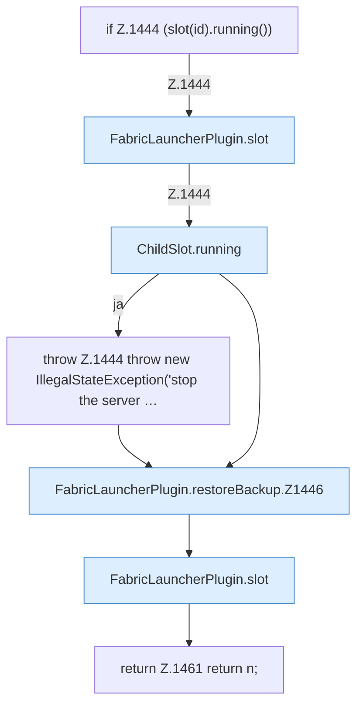

[[00 Start]] › [[Backup]] › [[Backup-Dateien]] › [[FabricLauncherPlugin.restoreBackup]]

# FabricLauncherPlugin.restoreBackup

`FabricLauncherPlugin.restoreBackup(String id, String name)` [src/main/java/de/aichele/childlauncher/FabricLauncherPlugin.java:1443–1462](https://github.com/Sciddie/minecraft-serverhoster-plugin/blob/95b02b953b0b4c23673e900e021a7c3c844aa37d/src/main/java/de/aichele/childlauncher/FabricLauncherPlugin.java#L1443-L1462)



```knoten
if Z.1444 (slot(id).running())
  Zeile 1444: prüft `(slot(id).running())`.
FabricLauncherPlugin.slot
  `slot` in `FabricLauncherPlugin.java`. Ruft `profile`, `ChildSlot`.
ChildSlot.running
  Sagt, ob der Prozess läuft `running`.
throw Z.1444 throw new IllegalStateException('stop the server …
  Zeile 1444: Abbruch `throw new IllegalStateException('stop the server …`.
FabricLauncherPlugin.restoreBackup.Z1446
  Fortsetzung des Ablaufs ab Zeile 1446.
return Z.1461 return n;
  Zeile 1461: Rückgabe `return n;`.
```

- `restoreBackup` in `src/main/java/de/aichele/childlauncher/FabricLauncherPlugin.java`
