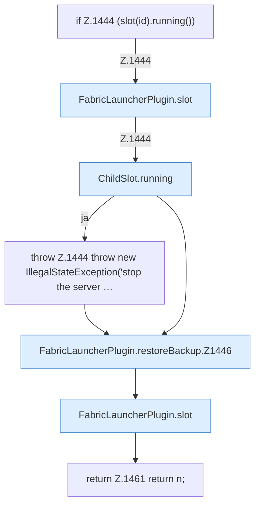

[[00 Start]] › [[Backup]] › [[Backup-Dateien]] › [[FabricLauncherPlugin.restoreBackup]]

# FabricLauncherPlugin.restoreBackup

`FabricLauncherPlugin.restoreBackup(String id, String name)` [src/main/java/de/aichele/childlauncher/FabricLauncherPlugin.java:1443–1462](https://github.com/Sciddie/minecraft-serverhoster-plugin/blob/95b02b953b0b4c23673e900e021a7c3c844aa37d/src/main/java/de/aichele/childlauncher/FabricLauncherPlugin.java#L1443-L1462)



```knoten
if Z.1444 (slot(id).running())
  Hier fällt eine Entscheidung. Nur wenn sie zutrifft, geht es den Ja-Weg weiter. Das steht in [[Glossar#Zeile|Zeile]] 1444.
FabricLauncherPlugin.slot
  Das [[Glossar#Plugin|Plugin]] macht hier einen einzelnen Schritt. Eine Ebene tiefer steht er genauer. Im [[Glossar#Quelltext|Quelltext]] heißt das `slot`.
ChildSlot.running
  Dieser Teil prüft, ob läuft, das. Im [[Glossar#Quelltext|Quelltext]] heißt das `running`.
throw Z.1444 throw new IllegalStateException('stop the server …
  Hier bricht die [[Glossar#Funktion|Funktion]] ab, weil etwas nicht geklappt hat. Das steht in [[Glossar#Zeile|Zeile]] 1444.
FabricLauncherPlugin.restoreBackup.Z1446
  Der Ablauf geht in [[Glossar#Zeile|Zeile]] 1446 weiter. Eine Ebene tiefer steht er genauer. Im [[Glossar#Quelltext|Quelltext]] heißt das `Z1446`.
return Z.1461 return n;
  Hier endet die [[Glossar#Funktion|Funktion]] und liefert ein Ergebnis zurück. Das steht in [[Glossar#Zeile|Zeile]] 1461.
```

> [!knoten]- Was die Blöcke tun
> - **if Z.1444 (slot(id).running())**: Hier fällt eine Entscheidung. Nur wenn sie zutrifft, geht es den Ja-Weg weiter. Das steht in [[Glossar#Zeile|Zeile]] 1444.
> - **FabricLauncherPlugin.slot**: Das [[Glossar#Plugin|Plugin]] macht hier einen einzelnen Schritt. Eine Ebene tiefer steht er genauer. Im [[Glossar#Quelltext|Quelltext]] heißt das `slot`.
> - **ChildSlot.running**: Dieser Teil prüft, ob läuft, das. Im [[Glossar#Quelltext|Quelltext]] heißt das `running`.
> - **throw Z.1444 throw new IllegalStateException('stop the server …**: Hier bricht die [[Glossar#Funktion|Funktion]] ab, weil etwas nicht geklappt hat. Das steht in [[Glossar#Zeile|Zeile]] 1444.
> - **FabricLauncherPlugin.restoreBackup.Z1446**: Der Ablauf geht in [[Glossar#Zeile|Zeile]] 1446 weiter. Eine Ebene tiefer steht er genauer. Im [[Glossar#Quelltext|Quelltext]] heißt das `Z1446`.
> - **return Z.1461 return n;**: Hier endet die [[Glossar#Funktion|Funktion]] und liefert ein Ergebnis zurück. Das steht in [[Glossar#Zeile|Zeile]] 1461.

- Das [[Glossar#Plugin|Plugin]] stellt wieder her die [[Glossar#Sicherungskopie|Sicherungskopie]].
