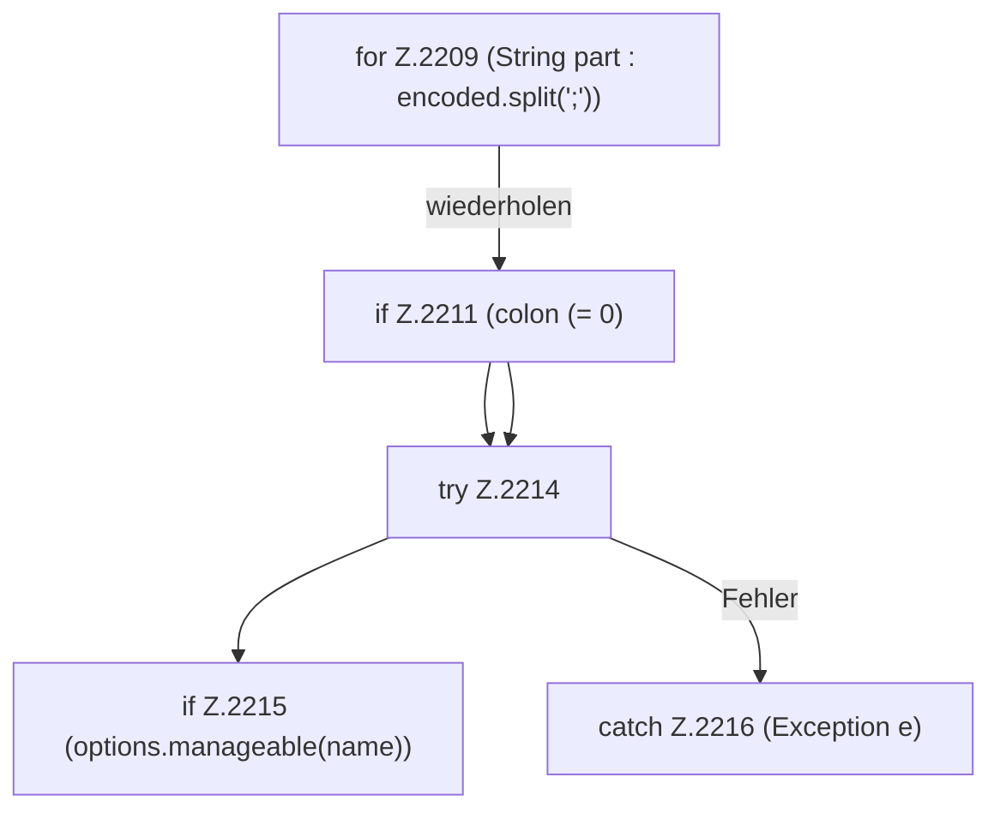

[[00 Start]] › [[Host-Betrieb]] › [[Host-Minimieren]] › [[Host-Minimieren.Teil1]] › [[FabricLauncherPlugin.restoreHostHeap]] › [[FabricLauncherPlugin.restoreHostHeap.Z2209]]

# FabricLauncherPlugin.restoreHostHeap.Z2209



```knoten
for Z.2209 (String part : encoded.split(';'))
  Zeile 2209: Schleife `(String part : encoded.split(';'))`.
if Z.2211 (colon (= 0)
  Zeile 2211: prüft `(colon (= 0)`.
try Z.2214
  Zeile 2214: Versuch. Der Fehlerpfad geht in catch.
if Z.2215 (options.manageable(name))
  Zeile 2215: prüft `(options.manageable(name))`.
catch Z.2216 (Exception e)
  Zeile 2216: fängt (Exception e).
```

- Fortsetzung von `FabricLauncherPlugin.restoreHostHeap`, Quellreihenfolge.
