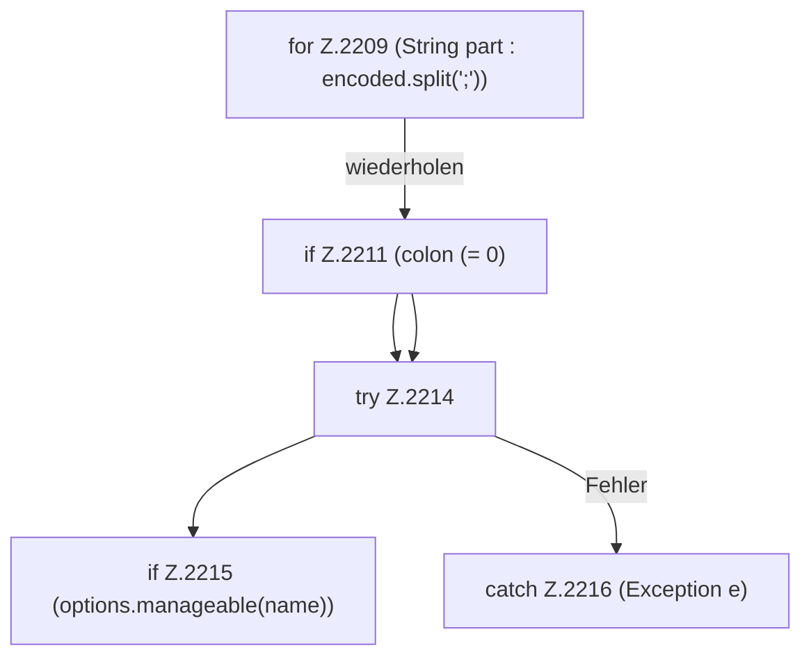

[[00 Start]] › [[Host-Betrieb]] › [[Host-Minimieren]] › [[Host-Minimieren.Teil1]] › [[FabricLauncherPlugin.restoreHostHeap]] › [[FabricLauncherPlugin.restoreHostHeap.Z2209]]

# FabricLauncherPlugin.restoreHostHeap.Z2209

- Fortsetzung von `FabricLauncherPlugin.restoreHostHeap`, Quellreihenfolge.
