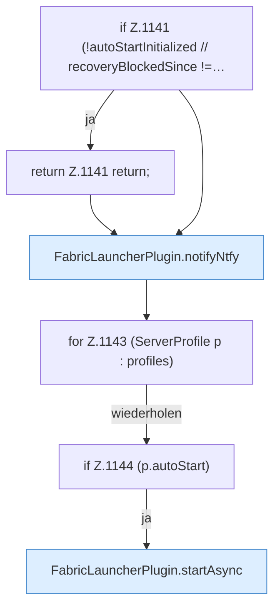

[[00 Start]] › [[Host-Betrieb]] › [[Speicher-Stopp]] › [[FabricLauncherPlugin.resumeConfiguredAutoStart]]

# FabricLauncherPlugin.resumeConfiguredAutoStart

`FabricLauncherPlugin.resumeConfiguredAutoStart()` [src/main/java/de/aichele/childlauncher/FabricLauncherPlugin.java:1140–1145](https://github.com/Sciddie/minecraft-serverhoster-plugin/blob/95b02b953b0b4c23673e900e021a7c3c844aa37d/src/main/java/de/aichele/childlauncher/FabricLauncherPlugin.java#L1140-L1145)



```knoten
if Z.1141 (!autoStartInitialized // recoveryBlockedSince !=…
  Zeile 1141: prüft `(!autoStartInitialized // recoveryBlockedSince !=…`.
return Z.1141 return;
  Zeile 1141: Rückgabe `return;`.
FabricLauncherPlugin.notifyNtfy
  Meldet `notifyNtfy`. Ruft `ntfySettings`, `backupCredentials`, `send`.
for Z.1143 (ServerProfile p : profiles)
  Zeile 1143: Schleife `(ServerProfile p : profiles)`.
if Z.1144 (p.autoStart)
  Zeile 1144: prüft `(p.autoStart)`.
FabricLauncherPlugin.startAsync
  Startet `startAsync`. Ruft `msg`, `slot`, `invalidateRestarts`.
```

- `resumeConfiguredAutoStart` in `src/main/java/de/aichele/childlauncher/FabricLauncherPlugin.java`
