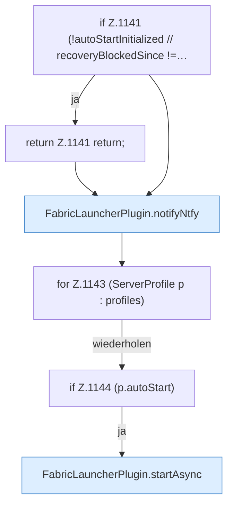

[[00 Start]] › [[Host-Betrieb]] › [[Speicher-Stopp]] › [[FabricLauncherPlugin.resumeConfiguredAutoStart]]

# FabricLauncherPlugin.resumeConfiguredAutoStart

`FabricLauncherPlugin.resumeConfiguredAutoStart()` [src/main/java/de/aichele/childlauncher/FabricLauncherPlugin.java:1140–1145](https://github.com/Sciddie/minecraft-serverhoster-plugin/blob/95b02b953b0b4c23673e900e021a7c3c844aa37d/src/main/java/de/aichele/childlauncher/FabricLauncherPlugin.java#L1140-L1145)



```knoten
if Z.1141 (!autoStartInitialized // recoveryBlockedSince !=…
  Hier fällt eine Entscheidung. Nur wenn sie zutrifft, geht es den Ja-Weg weiter. Das steht in [[Glossar#Zeile|Zeile]] 1141.
return Z.1141 return;
  Hier endet die [[Glossar#Funktion|Funktion]] und liefert ein Ergebnis zurück. Das steht in [[Glossar#Zeile|Zeile]] 1141.
FabricLauncherPlugin.notifyNtfy
  Das [[Glossar#Plugin|Plugin]] meldet den Mitteilungsdienst. Im [[Glossar#Quelltext|Quelltext]] heißt das `notifyNtfy`.
for Z.1143 (ServerProfile p : profiles)
  Dasselbe wird für jeden Eintrag wiederholt. Das steht in [[Glossar#Zeile|Zeile]] 1143.
if Z.1144 (p.autoStart)
  Hier fällt eine Entscheidung. Nur wenn sie zutrifft, geht es den Ja-Weg weiter. Das steht in [[Glossar#Zeile|Zeile]] 1144.
FabricLauncherPlugin.startAsync
  Beginnt den Start des [[Glossar#Spielserver|Spielservers]] im Hintergrund, damit der [[Glossar#Host|Host]] dabei nicht stehen bleibt. Im [[Glossar#Quelltext|Quelltext]] heißt das `startAsync`.
```

> [!knoten]- Was die Blöcke tun
> - **if Z.1141 (!autoStartInitialized // recoveryBlockedSince !=…**: Hier fällt eine Entscheidung. Nur wenn sie zutrifft, geht es den Ja-Weg weiter. Das steht in [[Glossar#Zeile|Zeile]] 1141.
> - **return Z.1141 return;**: Hier endet die [[Glossar#Funktion|Funktion]] und liefert ein Ergebnis zurück. Das steht in [[Glossar#Zeile|Zeile]] 1141.
> - **FabricLauncherPlugin.notifyNtfy**: Das [[Glossar#Plugin|Plugin]] meldet den Mitteilungsdienst. Im [[Glossar#Quelltext|Quelltext]] heißt das `notifyNtfy`.
> - **for Z.1143 (ServerProfile p : profiles)**: Dasselbe wird für jeden Eintrag wiederholt. Das steht in [[Glossar#Zeile|Zeile]] 1143.
> - **if Z.1144 (p.autoStart)**: Hier fällt eine Entscheidung. Nur wenn sie zutrifft, geht es den Ja-Weg weiter. Das steht in [[Glossar#Zeile|Zeile]] 1144.
> - **FabricLauncherPlugin.startAsync**: Beginnt den Start des [[Glossar#Spielserver|Spielservers]] im Hintergrund, damit der [[Glossar#Host|Host]] dabei nicht stehen bleibt. Im [[Glossar#Quelltext|Quelltext]] heißt das `startAsync`.

- Schaltet das automatische Starten wieder so ein, wie es in den [[Glossar#Einstellungen|Einstellungen]] steht.
