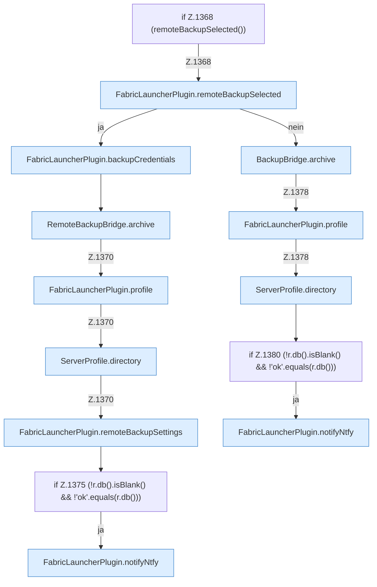

[[00 Start]] › [[Backup]] › [[Backup-Lauf]] › [[FabricLauncherPlugin.runBackup]] › [[FabricLauncherPlugin.runBackup.Z1360.Z1362.Z1368]]

# FabricLauncherPlugin.runBackup.Z1360.Z1362.Z1368



```knoten
if Z.1368 (remoteBackupSelected())
  Zeile 1368: prüft `(remoteBackupSelected())`.
FabricLauncherPlugin.remoteBackupSelected
  Das [[Glossar#Plugin|Plugin]] sichert die Auswahl. `remoteBackupSelected` in `FabricLauncherPlugin.java`.
FabricLauncherPlugin.backupCredentials
  Das [[Glossar#Plugin|Plugin]] sichert die Zugangsdaten. Sichert `backupCredentials`. Ruft `load`.
RemoteBackupBridge.archive
  Die Sicherung über das Netz macht hier einen einzelnen Schritt. Eine Ebene tiefer steht er genauer. Packt `archive`. Ruft `open`, `safeId`, `connect`.
FabricLauncherPlugin.profile
  Das [[Glossar#Plugin|Plugin]] macht hier einen einzelnen Schritt. Eine Ebene tiefer steht er genauer. `profile` in `FabricLauncherPlugin.java`.
ServerProfile.directory
  Die Serverbeschreibung macht hier einen einzelnen Schritt. Eine Ebene tiefer steht er genauer. `directory` in `ServerProfile.java`.
FabricLauncherPlugin.remoteBackupSettings
  Das [[Glossar#Plugin|Plugin]] sichert die [[Glossar#Einstellungen|Einstellungen]]. `remoteBackupSettings` in `FabricLauncherPlugin.java`.
if Z.1375 (!r.db().isBlank() && !'ok'.equals(r.db()))
  Zeile 1375: prüft `(!r.db().isBlank() && !'ok'.equals(r.db()))`.
FabricLauncherPlugin.notifyNtfy
  Das [[Glossar#Plugin|Plugin]] meldet den Mitteilungsdienst. Meldet `notifyNtfy`. Ruft `ntfySettings`, `backupCredentials`, `send`.
BackupBridge.archive
  Die Sicherung auf diesem Rechner macht hier einen einzelnen Schritt. Eine Ebene tiefer steht er genauer. Packt `archive`. Ruft `open`, `safeId`, `resolve`.
if Z.1380 (!r.db().isBlank() && !'ok'.equals(r.db()))
  Zeile 1380: prüft `(!r.db().isBlank() && !'ok'.equals(r.db()))`.
```

> [!knoten]- Was die Blöcke tun
> - **if Z.1368 (remoteBackupSelected())**: Zeile 1368: prüft `(remoteBackupSelected())`.
> - **FabricLauncherPlugin.remoteBackupSelected**: Das [[Glossar#Plugin|Plugin]] sichert die Auswahl. `remoteBackupSelected` in `FabricLauncherPlugin.java`.
> - **FabricLauncherPlugin.backupCredentials**: Das [[Glossar#Plugin|Plugin]] sichert die Zugangsdaten. Sichert `backupCredentials`. Ruft `load`.
> - **RemoteBackupBridge.archive**: Die Sicherung über das Netz macht hier einen einzelnen Schritt. Eine Ebene tiefer steht er genauer. Packt `archive`. Ruft `open`, `safeId`, `connect`.
> - **FabricLauncherPlugin.profile**: Das [[Glossar#Plugin|Plugin]] macht hier einen einzelnen Schritt. Eine Ebene tiefer steht er genauer. `profile` in `FabricLauncherPlugin.java`.
> - **ServerProfile.directory**: Die Serverbeschreibung macht hier einen einzelnen Schritt. Eine Ebene tiefer steht er genauer. `directory` in `ServerProfile.java`.
> - **FabricLauncherPlugin.remoteBackupSettings**: Das [[Glossar#Plugin|Plugin]] sichert die [[Glossar#Einstellungen|Einstellungen]]. `remoteBackupSettings` in `FabricLauncherPlugin.java`.
> - **if Z.1375 (!r.db().isBlank() && !'ok'.equals(r.db()))**: Zeile 1375: prüft `(!r.db().isBlank() && !'ok'.equals(r.db()))`.
> - **FabricLauncherPlugin.notifyNtfy**: Das [[Glossar#Plugin|Plugin]] meldet den Mitteilungsdienst. Meldet `notifyNtfy`. Ruft `ntfySettings`, `backupCredentials`, `send`.
> - **BackupBridge.archive**: Die Sicherung auf diesem Rechner macht hier einen einzelnen Schritt. Eine Ebene tiefer steht er genauer. Packt `archive`. Ruft `open`, `safeId`, `resolve`.
> - **if Z.1380 (!r.db().isBlank() && !'ok'.equals(r.db()))**: Zeile 1380: prüft `(!r.db().isBlank() && !'ok'.equals(r.db()))`.

- Der Ablauf geht in [[Glossar#Zeile|Zeile]] 1368 weiter. Eine Ebene tiefer steht er genauer.
- Fortsetzung von `FabricLauncherPlugin.runBackup.Z1360.Z1362`.
