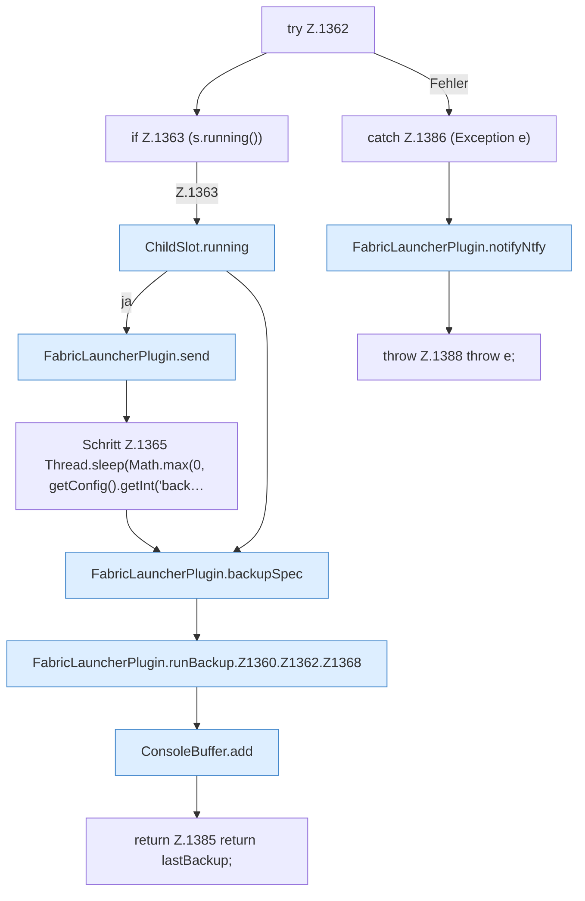

[[00 Start]] › [[Backup]] › [[Backup-Lauf]] › [[FabricLauncherPlugin.runBackup]] › [[FabricLauncherPlugin.runBackup.Z1360.Z1362]]

# FabricLauncherPlugin.runBackup.Z1360.Z1362

- Fortsetzung von `FabricLauncherPlugin.runBackup.Z1360`, Quellreihenfolge.
