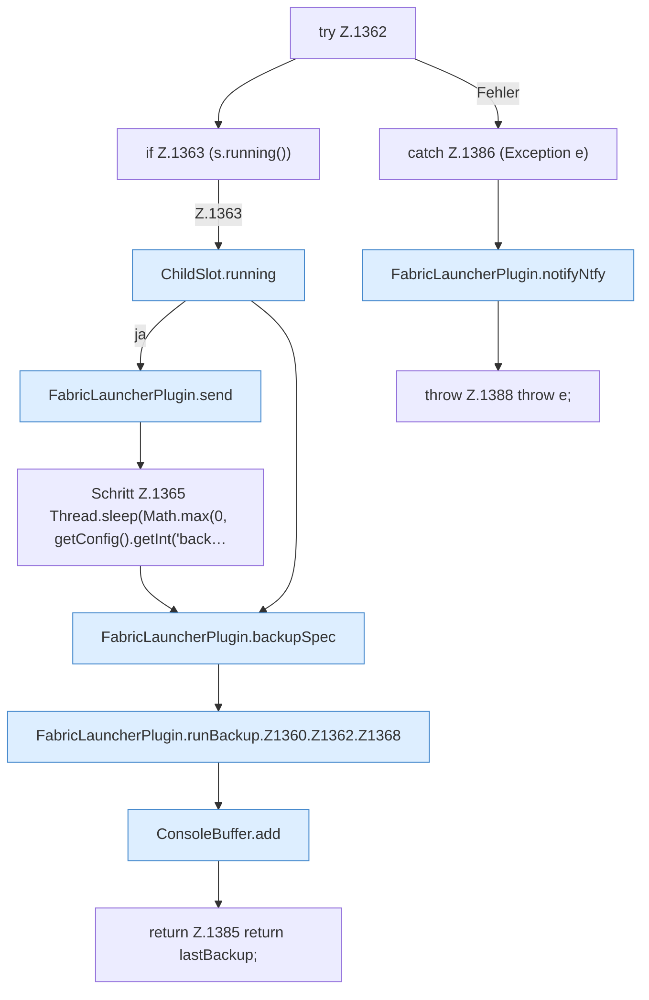

[[00 Start]] › [[Backup]] › [[Backup-Lauf]] › [[FabricLauncherPlugin.runBackup]] › [[FabricLauncherPlugin.runBackup.Z1360.Z1362]]

# FabricLauncherPlugin.runBackup.Z1360.Z1362



```knoten
try Z.1362
  Zeile 1362: Versuch. Der Fehlerpfad geht in catch.
if Z.1363 (s.running())
  Zeile 1363: prüft `(s.running())`.
ChildSlot.running
  Sagt, ob der Prozess läuft `running`.
FabricLauncherPlugin.send
  Sendet `send`. Ruft `running`.
Schritt Z.1365 Thread.sleep(Math.max(0, getConfig().getInt('back…
  Zeile 1365: liest die Config. `Thread.sleep(Math.max(0, getConfig().getInt('back…`
FabricLauncherPlugin.backupSpec
  Sichert `backupSpec`.
FabricLauncherPlugin.runBackup.Z1360.Z1362.Z1368
  Fortsetzung des Ablaufs ab Zeile 1368.
ConsoleBuffer.add
  Fügt hinzu `add`.
return Z.1385 return lastBackup;
  Zeile 1385: Rückgabe `return lastBackup;`.
catch Z.1386 (Exception e)
  Zeile 1386: fängt (Exception e).
FabricLauncherPlugin.notifyNtfy
  Meldet `notifyNtfy`. Ruft `ntfySettings`, `backupCredentials`, `send`.
throw Z.1388 throw e;
  Zeile 1388: Abbruch `throw e;`.
```

- Fortsetzung von `FabricLauncherPlugin.runBackup.Z1360`, Quellreihenfolge.
