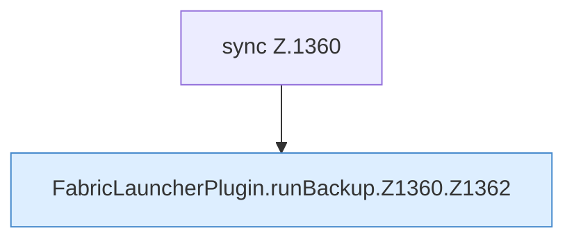

[[00 Start]] › [[Backup]] › [[Backup-Lauf]] › [[FabricLauncherPlugin.runBackup]] › [[FabricLauncherPlugin.runBackup.Z1360]]

# FabricLauncherPlugin.runBackup.Z1360

- Fortsetzung von `FabricLauncherPlugin.runBackup`, Quellreihenfolge.
