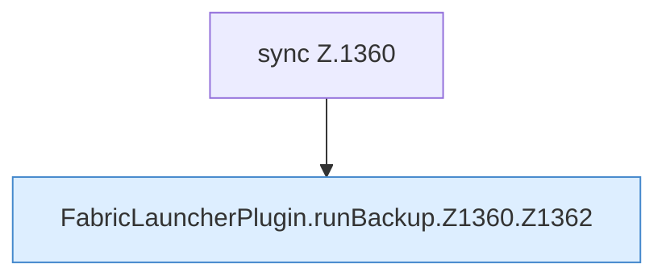

[[00 Start]] › [[Backup]] › [[Backup-Lauf]] › [[FabricLauncherPlugin.runBackup]] › [[FabricLauncherPlugin.runBackup.Z1360]]

# FabricLauncherPlugin.runBackup.Z1360



```knoten
sync Z.1360
  Zeile 1360: synchronisierter Block.
FabricLauncherPlugin.runBackup.Z1360.Z1362
  Der Ablauf geht in [[Glossar#Zeile|Zeile]] 1362 weiter. Eine Ebene tiefer steht er genauer. Fortsetzung des Ablaufs ab Zeile 1362.
```

> [!knoten]- Was die Blöcke tun
> - **sync Z.1360**: Zeile 1360: synchronisierter Block.
> - **FabricLauncherPlugin.runBackup.Z1360.Z1362**: Der Ablauf geht in [[Glossar#Zeile|Zeile]] 1362 weiter. Eine Ebene tiefer steht er genauer. Fortsetzung des Ablaufs ab Zeile 1362.

- Der Ablauf geht in [[Glossar#Zeile|Zeile]] 1360 weiter. Eine Ebene tiefer steht er genauer.
- Fortsetzung von `FabricLauncherPlugin.runBackup`.
