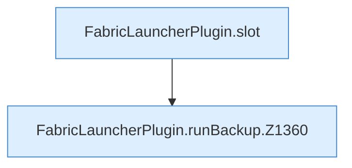

[[00 Start]] › [[Backup]] › [[Backup-Lauf]] › [[FabricLauncherPlugin.runBackup]]

# FabricLauncherPlugin.runBackup

`FabricLauncherPlugin.runBackup(String id)` [src/main/java/de/aichele/childlauncher/FabricLauncherPlugin.java:1359–1391](https://github.com/Sciddie/minecraft-serverhoster-plugin/blob/95b02b953b0b4c23673e900e021a7c3c844aa37d/src/main/java/de/aichele/childlauncher/FabricLauncherPlugin.java#L1359-L1391)



```knoten
FabricLauncherPlugin.slot
  `slot` in `FabricLauncherPlugin.java`. Ruft `profile`, `ChildSlot`.
FabricLauncherPlugin.runBackup.Z1360
  Fortsetzung des Ablaufs ab Zeile 1360.
```

- `runBackup` in `src/main/java/de/aichele/childlauncher/FabricLauncherPlugin.java`
