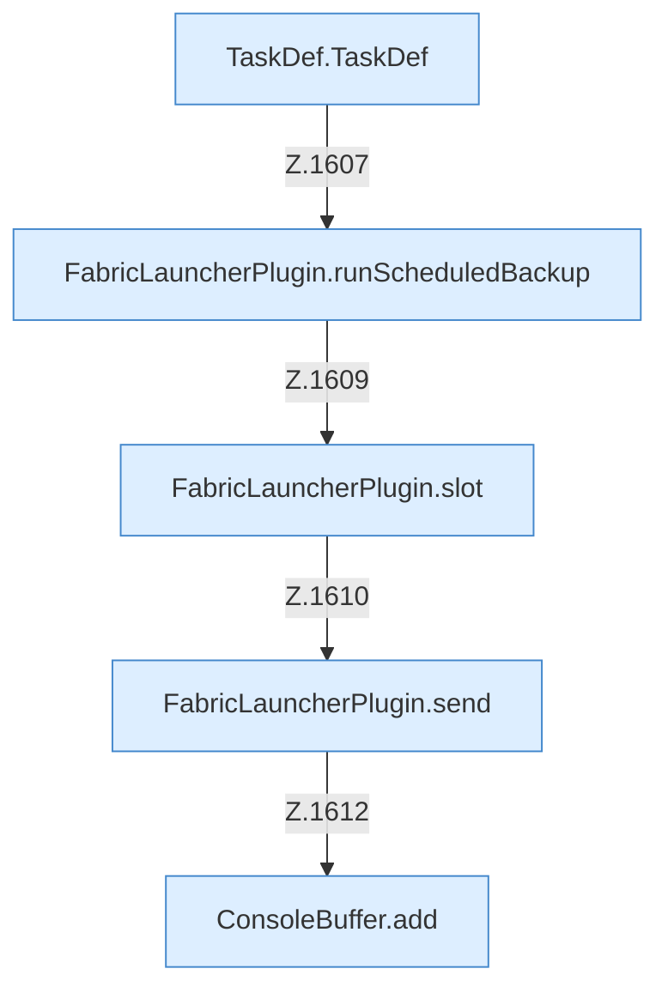

[[00 Start]] › [[Zeitplaene]] › [[Schedules]] › [[FabricLauncherPlugin.runSchedule]] › [[FabricLauncherPlugin.runSchedule.Aufrufe]]

# FabricLauncherPlugin.runSchedule.Aufrufe



```knoten
TaskDef.TaskDef
  `TaskDef` in `TaskDef.java`. Ruft `normZone`, `normAction`.
FabricLauncherPlugin.runScheduledBackup
  Führt aus `runScheduledBackup`. Ruft `slot`, `running`, `add`.
FabricLauncherPlugin.slot
  `slot` in `FabricLauncherPlugin.java`. Ruft `profile`, `ChildSlot`.
FabricLauncherPlugin.send
  Sendet `send`. Ruft `running`.
ConsoleBuffer.add
  Fügt hinzu `add`.
```

- Fortsetzung von `FabricLauncherPlugin.runSchedule`, Quellreihenfolge.
- ungeprüft: Ablaufparser oder nachgetragene Aufrufe, siehe [[bericht]].
