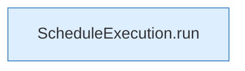

[[00 Start]] › [[Zeitplaene]] › [[Schedules]] › [[FabricLauncherPlugin.runSchedule]] › [[FabricLauncherPlugin.runSchedule.Z1602.Z1603]]

# FabricLauncherPlugin.runSchedule.Z1602.Z1603



```knoten
ScheduleExecution.run
  Dieser Teil führt aus das. Führt aus `run`.
```

> [!knoten]- Was die Blöcke tun
> - **ScheduleExecution.run**: Dieser Teil führt aus das. Führt aus `run`.

- Der Ablauf geht in [[Glossar#Zeile|Zeile]] 1603 weiter. Eine Ebene tiefer steht er genauer.
- Fortsetzung von `FabricLauncherPlugin.runSchedule.Z1602`.
