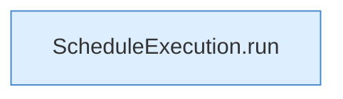

[[00 Start]] › [[Zeitplaene]] › [[Schedules]] › [[FabricLauncherPlugin.runSchedule]] › [[FabricLauncherPlugin.runSchedule.Z1602.Z1603]]

# FabricLauncherPlugin.runSchedule.Z1602.Z1603

- Fortsetzung von `FabricLauncherPlugin.runSchedule.Z1602`, Quellreihenfolge.
