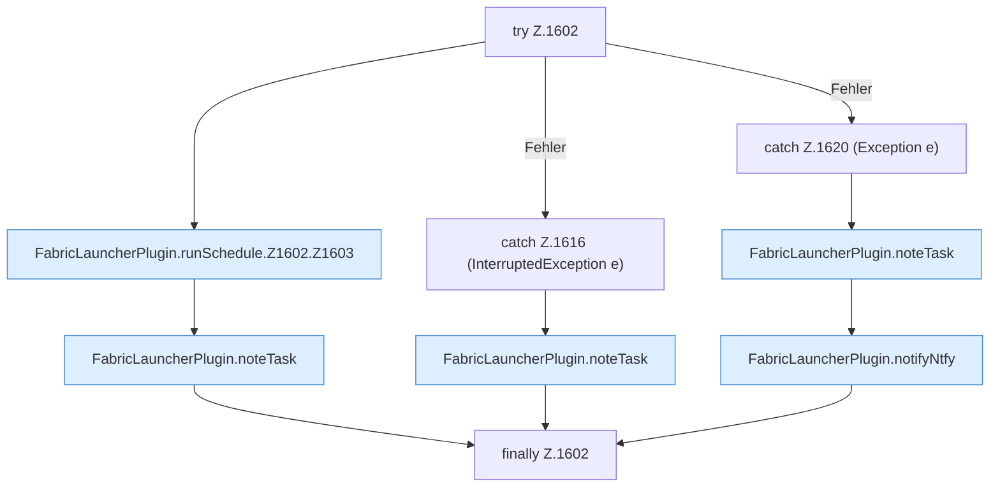

[[00 Start]] › [[Zeitplaene]] › [[Schedules]] › [[FabricLauncherPlugin.runSchedule]] › [[FabricLauncherPlugin.runSchedule.Z1602]]

# FabricLauncherPlugin.runSchedule.Z1602

- Fortsetzung von `FabricLauncherPlugin.runSchedule`, Quellreihenfolge.
