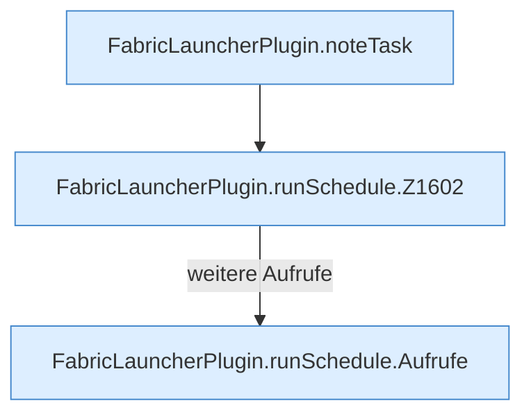

[[00 Start]] › [[Zeitplaene]] › [[Schedules]] › [[FabricLauncherPlugin.runSchedule]]

# FabricLauncherPlugin.runSchedule

`FabricLauncherPlugin.runSchedule(ScheduleDef schedule)` [src/main/java/de/aichele/childlauncher/FabricLauncherPlugin.java:1600–1627](https://github.com/Sciddie/minecraft-serverhoster-plugin/blob/95b02b953b0b4c23673e900e021a7c3c844aa37d/src/main/java/de/aichele/childlauncher/FabricLauncherPlugin.java#L1600-L1627)



```knoten
FabricLauncherPlugin.noteTask
  Merkt `noteTask`.
FabricLauncherPlugin.runSchedule.Z1602
  Fortsetzung des Ablaufs ab Zeile 1602.
FabricLauncherPlugin.runSchedule.Aufrufe
  Eigene Aufrufe, die der Parser nicht in den gezeichneten Ablauf gesetzt hat.
```

- `runSchedule` in `src/main/java/de/aichele/childlauncher/FabricLauncherPlugin.java`
- ungeprüft: Ablaufparser oder nachgetragene Aufrufe, siehe [[bericht]].
