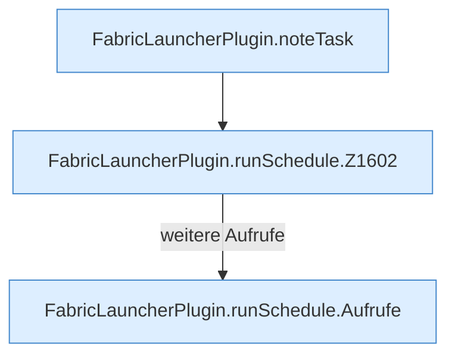

[[00 Start]] › [[Zeitplaene]] › [[Schedules]] › [[FabricLauncherPlugin.runSchedule]]

# FabricLauncherPlugin.runSchedule

`FabricLauncherPlugin.runSchedule(ScheduleDef schedule)` [src/main/java/de/aichele/childlauncher/FabricLauncherPlugin.java:1600–1627](https://github.com/Sciddie/minecraft-serverhoster-plugin/blob/95b02b953b0b4c23673e900e021a7c3c844aa37d/src/main/java/de/aichele/childlauncher/FabricLauncherPlugin.java#L1600-L1627)



```knoten
FabricLauncherPlugin.noteTask
  Schreibt auf, dass eine [[Glossar#Aufgabe|Aufgabe]] gelaufen ist. Im [[Glossar#Quelltext|Quelltext]] heißt das `noteTask`.
FabricLauncherPlugin.runSchedule.Z1602
  Der Ablauf geht in [[Glossar#Zeile|Zeile]] 1602 weiter. Eine Ebene tiefer steht er genauer. Im [[Glossar#Quelltext|Quelltext]] heißt das `Z1602`.
FabricLauncherPlugin.runSchedule.Aufrufe
  Aufrufe, die das Diagramm nicht in den gezeichneten Ablauf gesetzt hat. Im [[Glossar#Quelltext|Quelltext]] heißt das `Aufrufe`.
```

> [!knoten]- Was die Blöcke tun
> - **FabricLauncherPlugin.noteTask**: Schreibt auf, dass eine [[Glossar#Aufgabe|Aufgabe]] gelaufen ist. Im [[Glossar#Quelltext|Quelltext]] heißt das `noteTask`.
> - **FabricLauncherPlugin.runSchedule.Z1602**: Der Ablauf geht in [[Glossar#Zeile|Zeile]] 1602 weiter. Eine Ebene tiefer steht er genauer. Im [[Glossar#Quelltext|Quelltext]] heißt das `Z1602`.
> - **FabricLauncherPlugin.runSchedule.Aufrufe**: Aufrufe, die das Diagramm nicht in den gezeichneten Ablauf gesetzt hat. Im [[Glossar#Quelltext|Quelltext]] heißt das `Aufrufe`.

- Das [[Glossar#Plugin|Plugin]] führt aus den [[Glossar#Zeitplan|Zeitplan]].
- ungeprüft: Ablaufparser oder nachgetragene Aufrufe, siehe [[bericht]].
