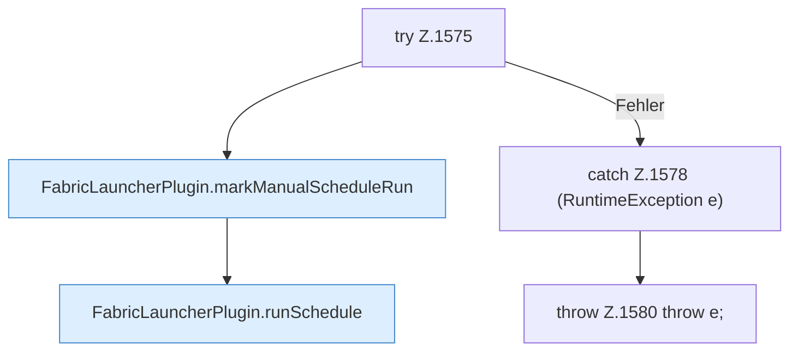

[[00 Start]] › [[Zeitplaene]] › [[Schedules]] › [[FabricLauncherPlugin.runScheduleNow]] › [[FabricLauncherPlugin.runScheduleNow.Z1575]]

# FabricLauncherPlugin.runScheduleNow.Z1575

- Fortsetzung von `FabricLauncherPlugin.runScheduleNow`, Quellreihenfolge.
