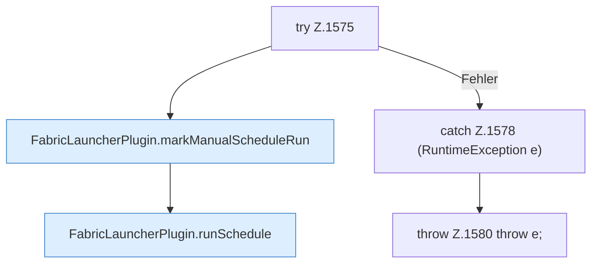

[[00 Start]] › [[Zeitplaene]] › [[Schedules]] › [[FabricLauncherPlugin.runScheduleNow]] › [[FabricLauncherPlugin.runScheduleNow.Z1575]]

# FabricLauncherPlugin.runScheduleNow.Z1575



```knoten
try Z.1575
  Zeile 1575: Versuch. Der Fehlerpfad geht in catch.
FabricLauncherPlugin.markManualScheduleRun
  Merkt `markManualScheduleRun`. Ruft `schedules`, `sameScheduleMinute`, `withLastRun`.
FabricLauncherPlugin.runSchedule
  Führt aus `runSchedule`. Ruft `noteTask`, `run`, `TaskDef`.
catch Z.1578 (RuntimeException e)
  Zeile 1578: fängt (RuntimeException e).
throw Z.1580 throw e;
  Zeile 1580: Abbruch `throw e;`.
```

- Fortsetzung von `FabricLauncherPlugin.runScheduleNow`, Quellreihenfolge.
