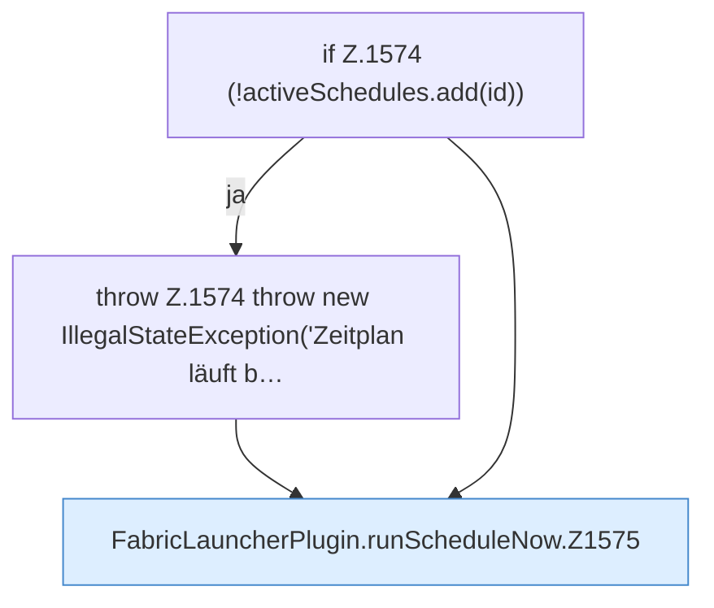

[[00 Start]] › [[Zeitplaene]] › [[Schedules]] › [[FabricLauncherPlugin.runScheduleNow]]

# FabricLauncherPlugin.runScheduleNow

`FabricLauncherPlugin.runScheduleNow(String id)` [src/main/java/de/aichele/childlauncher/FabricLauncherPlugin.java:1573–1582](https://github.com/Sciddie/minecraft-serverhoster-plugin/blob/95b02b953b0b4c23673e900e021a7c3c844aa37d/src/main/java/de/aichele/childlauncher/FabricLauncherPlugin.java#L1573-L1582)



```knoten
if Z.1574 (!activeSchedules.add(id))
  Hier fällt eine Entscheidung. Nur wenn sie zutrifft, geht es den Ja-Weg weiter. Das steht in [[Glossar#Zeile|Zeile]] 1574.
throw Z.1574 throw new IllegalStateException('Zeitplan läuft b…
  Hier bricht die [[Glossar#Funktion|Funktion]] ab, weil etwas nicht geklappt hat. Das steht in [[Glossar#Zeile|Zeile]] 1574.
FabricLauncherPlugin.runScheduleNow.Z1575
  Der Ablauf geht in [[Glossar#Zeile|Zeile]] 1575 weiter. Eine Ebene tiefer steht er genauer. Im [[Glossar#Quelltext|Quelltext]] heißt das `Z1575`.
```

> [!knoten]- Was die Blöcke tun
> - **if Z.1574 (!activeSchedules.add(id))**: Hier fällt eine Entscheidung. Nur wenn sie zutrifft, geht es den Ja-Weg weiter. Das steht in [[Glossar#Zeile|Zeile]] 1574.
> - **throw Z.1574 throw new IllegalStateException('Zeitplan läuft b…**: Hier bricht die [[Glossar#Funktion|Funktion]] ab, weil etwas nicht geklappt hat. Das steht in [[Glossar#Zeile|Zeile]] 1574.
> - **FabricLauncherPlugin.runScheduleNow.Z1575**: Der Ablauf geht in [[Glossar#Zeile|Zeile]] 1575 weiter. Eine Ebene tiefer steht er genauer. Im [[Glossar#Quelltext|Quelltext]] heißt das `Z1575`.

- Das [[Glossar#Plugin|Plugin]] führt aus den [[Glossar#Zeitplan|Zeitplan]] sofort.
