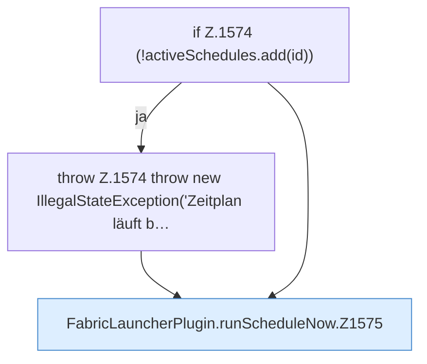

[[00 Start]] › [[Zeitplaene]] › [[Schedules]] › [[FabricLauncherPlugin.runScheduleNow]]

# FabricLauncherPlugin.runScheduleNow

`FabricLauncherPlugin.runScheduleNow(String id)` [src/main/java/de/aichele/childlauncher/FabricLauncherPlugin.java:1573–1582](https://github.com/Sciddie/minecraft-serverhoster-plugin/blob/95b02b953b0b4c23673e900e021a7c3c844aa37d/src/main/java/de/aichele/childlauncher/FabricLauncherPlugin.java#L1573-L1582)



```knoten
if Z.1574 (!activeSchedules.add(id))
  Zeile 1574: prüft `(!activeSchedules.add(id))`.
throw Z.1574 throw new IllegalStateException('Zeitplan läuft b…
  Zeile 1574: Abbruch `throw new IllegalStateException('Zeitplan läuft b…`.
FabricLauncherPlugin.runScheduleNow.Z1575
  Fortsetzung des Ablaufs ab Zeile 1575.
```

- `runScheduleNow` in `src/main/java/de/aichele/childlauncher/FabricLauncherPlugin.java`
