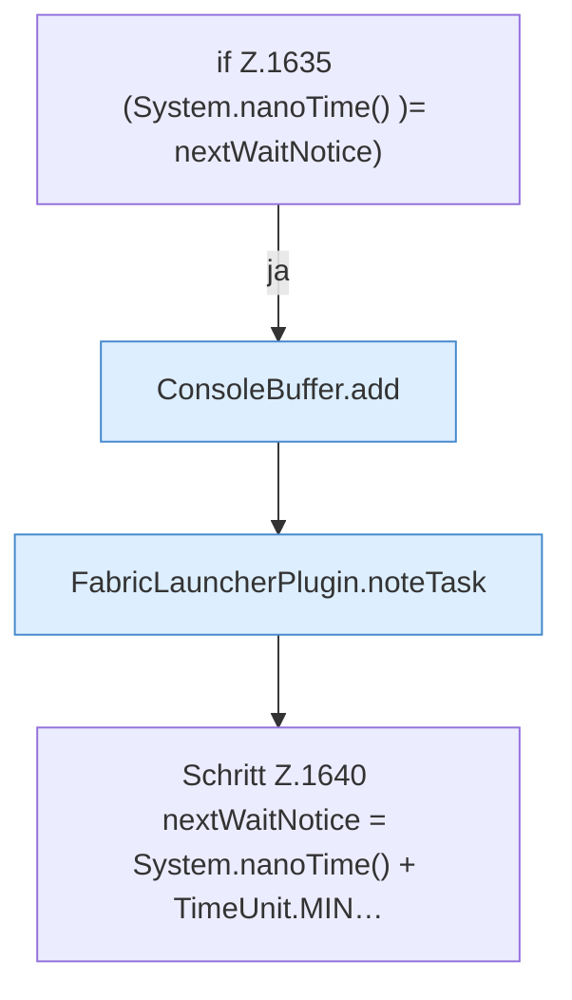

[[00 Start]] › [[Backup]] › [[Backup-Lauf]] › [[FabricLauncherPlugin.runScheduledBackup]] › [[FabricLauncherPlugin.runScheduledBackup.Z1632.Z1633.Z1635]]

# FabricLauncherPlugin.runScheduledBackup.Z1632.Z1633.Z1635

- Fortsetzung von `FabricLauncherPlugin.runScheduledBackup.Z1632.Z1633`, Quellreihenfolge.
