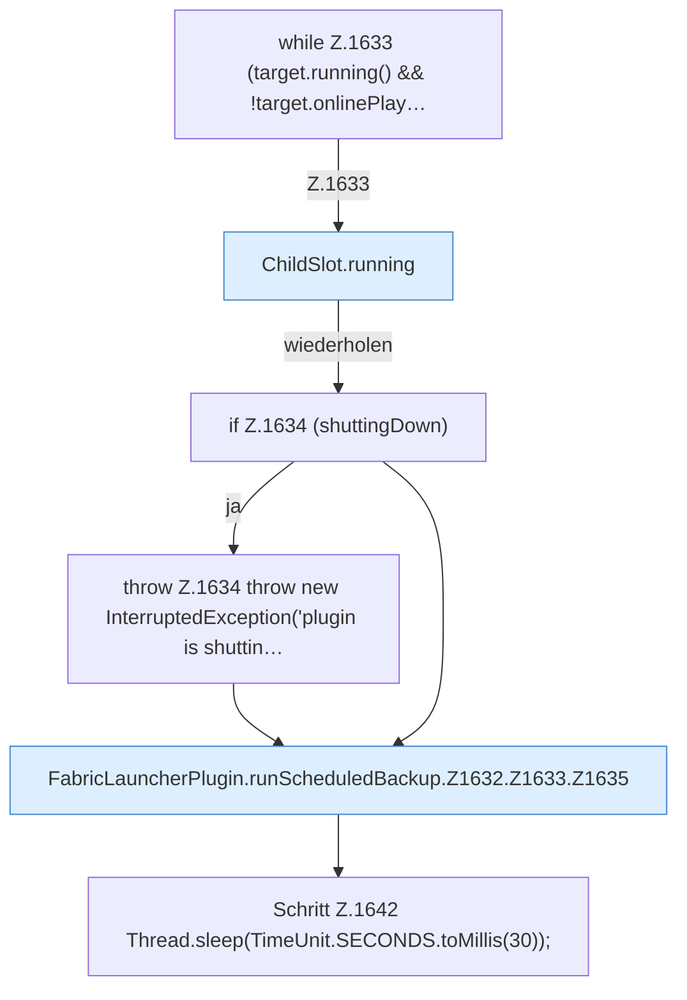

[[00 Start]] › [[Backup]] › [[Backup-Lauf]] › [[FabricLauncherPlugin.runScheduledBackup]] › [[FabricLauncherPlugin.runScheduledBackup.Z1632.Z1633]]

# FabricLauncherPlugin.runScheduledBackup.Z1632.Z1633



```knoten
while Z.1633 (target.running() && !target.onlinePlay…
  Zeile 1633: Schleife `(target.running() && !target.onlinePlay…`.
ChildSlot.running
  Dieser Teil prüft, ob läuft, das. Sagt, ob der [[Glossar#Prozess|Prozess]] läuft `running`.
if Z.1634 (shuttingDown)
  Zeile 1634: prüft `(shuttingDown)`.
throw Z.1634 throw new InterruptedException('plugin is shuttin…
  Zeile 1634: Abbruch `throw new InterruptedException('plugin is shuttin…`.
FabricLauncherPlugin.runScheduledBackup.Z1632.Z1633.Z1635
  Der Ablauf geht in [[Glossar#Zeile|Zeile]] 1635 weiter. Eine Ebene tiefer steht er genauer. Fortsetzung des Ablaufs ab Zeile 1635.
Schritt Z.1642 Thread.sleep(TimeUnit.SECONDS.toMillis(30));
  Zeile 1642: wartet. `Thread.sleep(TimeUnit.SECONDS.toMillis(30));`
```

> [!knoten]- Was die Blöcke tun
> - **while Z.1633 (target.running() && !target.onlinePlay…**: Zeile 1633: Schleife `(target.running() && !target.onlinePlay…`.
> - **ChildSlot.running**: Dieser Teil prüft, ob läuft, das. Sagt, ob der [[Glossar#Prozess|Prozess]] läuft `running`.
> - **if Z.1634 (shuttingDown)**: Zeile 1634: prüft `(shuttingDown)`.
> - **throw Z.1634 throw new InterruptedException('plugin is shuttin…**: Zeile 1634: Abbruch `throw new InterruptedException('plugin is shuttin…`.
> - **FabricLauncherPlugin.runScheduledBackup.Z1632.Z1633.Z1635**: Der Ablauf geht in [[Glossar#Zeile|Zeile]] 1635 weiter. Eine Ebene tiefer steht er genauer. Fortsetzung des Ablaufs ab Zeile 1635.
> - **Schritt Z.1642 Thread.sleep(TimeUnit.SECONDS.toMillis(30));**: Zeile 1642: wartet. `Thread.sleep(TimeUnit.SECONDS.toMillis(30));`

- Der Ablauf geht in [[Glossar#Zeile|Zeile]] 1633 weiter. Eine Ebene tiefer steht er genauer.
- Fortsetzung von `FabricLauncherPlugin.runScheduledBackup.Z1632`.
