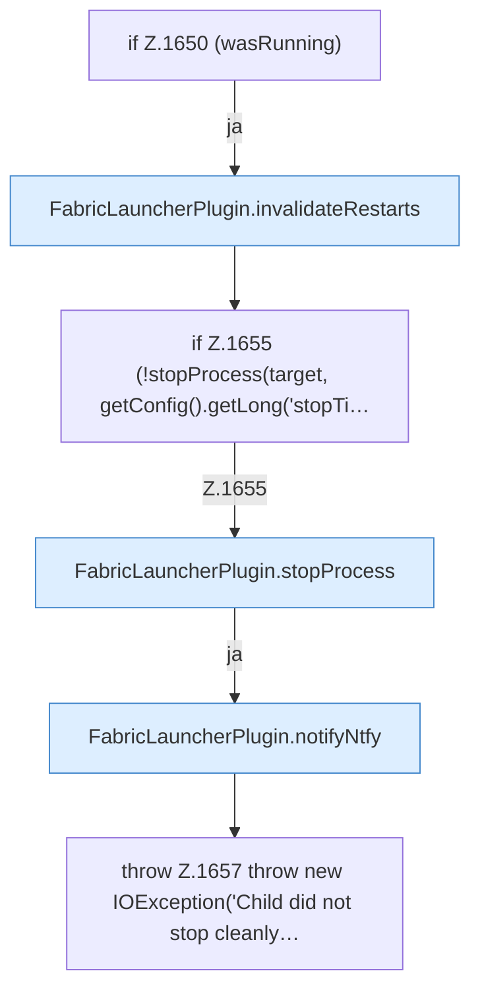

[[00 Start]] › [[Backup]] › [[Backup-Lauf]] › [[FabricLauncherPlugin.runScheduledBackup]] › [[FabricLauncherPlugin.runScheduledBackup.Z1632.Z1643.Z1649.Z1650]]

# FabricLauncherPlugin.runScheduledBackup.Z1632.Z1643.Z1649.Z1650



```knoten
if Z.1650 (wasRunning)
  Zeile 1650: prüft `(wasRunning)`.
FabricLauncherPlugin.invalidateRestarts
  Vergisst geplante [[Glossar#Neustart|Neustarts]], damit ein absichtlicher [[Glossar#Stopp|Stopp]] nicht gleich wieder startet. Verwirft `invalidateRestarts`.
if Z.1655 (!stopProcess(target, getConfig().getLong('stopTi…
  Zeile 1655: prüft `(!stopProcess(target, getConfig().getLong('stopTi…`.
FabricLauncherPlugin.stopProcess
  Fährt den [[Glossar#Spielserver|Spielserver]] herunter: erst die Bitte, dann Warten, dann ein hartes Beenden. Stoppt `stopProcess`. Ruft `add`, `boundedSeconds`, `warnOnce`.
FabricLauncherPlugin.notifyNtfy
  Das [[Glossar#Plugin|Plugin]] meldet den Mitteilungsdienst. Meldet `notifyNtfy`. Ruft `ntfySettings`, `backupCredentials`, `send`.
throw Z.1657 throw new IOException('Child did not stop cleanly…
  Zeile 1657: Abbruch `throw new IOException('Child did not stop cleanly…`.
```

> [!knoten]- Was die Blöcke tun
> - **if Z.1650 (wasRunning)**: Zeile 1650: prüft `(wasRunning)`.
> - **FabricLauncherPlugin.invalidateRestarts**: Vergisst geplante [[Glossar#Neustart|Neustarts]], damit ein absichtlicher [[Glossar#Stopp|Stopp]] nicht gleich wieder startet. Verwirft `invalidateRestarts`.
> - **if Z.1655 (!stopProcess(target, getConfig().getLong('stopTi…**: Zeile 1655: prüft `(!stopProcess(target, getConfig().getLong('stopTi…`.
> - **FabricLauncherPlugin.stopProcess**: Fährt den [[Glossar#Spielserver|Spielserver]] herunter: erst die Bitte, dann Warten, dann ein hartes Beenden. Stoppt `stopProcess`. Ruft `add`, `boundedSeconds`, `warnOnce`.
> - **FabricLauncherPlugin.notifyNtfy**: Das [[Glossar#Plugin|Plugin]] meldet den Mitteilungsdienst. Meldet `notifyNtfy`. Ruft `ntfySettings`, `backupCredentials`, `send`.
> - **throw Z.1657 throw new IOException('Child did not stop cleanly…**: Zeile 1657: Abbruch `throw new IOException('Child did not stop cleanly…`.

- Der Ablauf geht in [[Glossar#Zeile|Zeile]] 1650 weiter. Eine Ebene tiefer steht er genauer.
- Fortsetzung von `FabricLauncherPlugin.runScheduledBackup.Z1632.Z1643.Z1649`.
