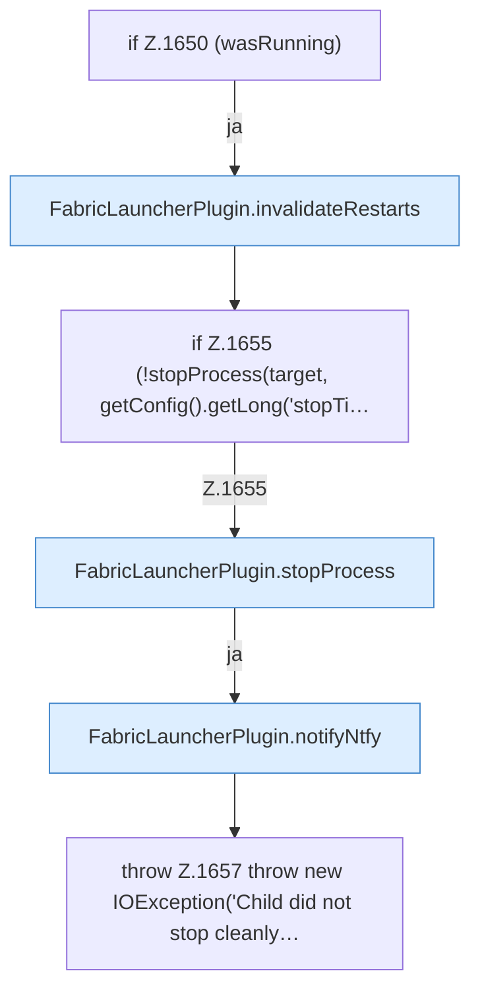

[[00 Start]] › [[Backup]] › [[Backup-Lauf]] › [[FabricLauncherPlugin.runScheduledBackup]] › [[FabricLauncherPlugin.runScheduledBackup.Z1632.Z1643.Z1649.Z1650]]

# FabricLauncherPlugin.runScheduledBackup.Z1632.Z1643.Z1649.Z1650



```knoten
if Z.1650 (wasRunning)
  Zeile 1650: prüft `(wasRunning)`.
FabricLauncherPlugin.invalidateRestarts
  Verwirft `invalidateRestarts`.
if Z.1655 (!stopProcess(target, getConfig().getLong('stopTi…
  Zeile 1655: prüft `(!stopProcess(target, getConfig().getLong('stopTi…`.
FabricLauncherPlugin.stopProcess
  Stoppt `stopProcess`. Ruft `add`, `boundedSeconds`, `warnOnce`.
FabricLauncherPlugin.notifyNtfy
  Meldet `notifyNtfy`. Ruft `ntfySettings`, `backupCredentials`, `send`.
throw Z.1657 throw new IOException('Child did not stop cleanly…
  Zeile 1657: Abbruch `throw new IOException('Child did not stop cleanly…`.
```

- Fortsetzung von `FabricLauncherPlugin.runScheduledBackup.Z1632.Z1643.Z1649`, Quellreihenfolge.
