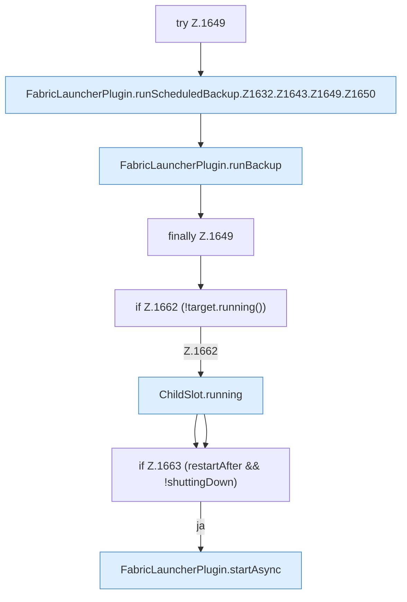

[[00 Start]] › [[Backup]] › [[Backup-Lauf]] › [[FabricLauncherPlugin.runScheduledBackup]] › [[FabricLauncherPlugin.runScheduledBackup.Z1632.Z1643.Z1649]]

# FabricLauncherPlugin.runScheduledBackup.Z1632.Z1643.Z1649



```knoten
try Z.1649
  Zeile 1649: Versuch. Der Fehlerpfad geht in catch.
FabricLauncherPlugin.runScheduledBackup.Z1632.Z1643.Z1649.Z1650
  Der Ablauf geht in [[Glossar#Zeile|Zeile]] 1650 weiter. Eine Ebene tiefer steht er genauer. Fortsetzung des Ablaufs ab Zeile 1650.
FabricLauncherPlugin.runBackup
  Das [[Glossar#Plugin|Plugin]] führt aus die [[Glossar#Sicherungskopie|Sicherungskopie]]. Führt aus `runBackup`. Ruft `slot`, `running`, `send`.
finally Z.1649
  Läuft danach immer, auch nach einem Fehler.
if Z.1662 (!target.running())
  Zeile 1662: prüft `(!target.running())`.
ChildSlot.running
  Dieser Teil prüft, ob läuft, das. Sagt, ob der [[Glossar#Prozess|Prozess]] läuft `running`.
if Z.1663 (restartAfter && !shuttingDown)
  Zeile 1663: prüft `(restartAfter && !shuttingDown)`.
FabricLauncherPlugin.startAsync
  Beginnt den Start des [[Glossar#Spielserver|Spielservers]] im Hintergrund, damit der [[Glossar#Host|Host]] dabei nicht stehen bleibt. Startet `startAsync`. Ruft `msg`, `slot`, `invalidateRestarts`.
```

> [!knoten]- Was die Blöcke tun
> - **try Z.1649**: Zeile 1649: Versuch. Der Fehlerpfad geht in catch.
> - **FabricLauncherPlugin.runScheduledBackup.Z1632.Z1643.Z1649.Z1650**: Der Ablauf geht in [[Glossar#Zeile|Zeile]] 1650 weiter. Eine Ebene tiefer steht er genauer. Fortsetzung des Ablaufs ab Zeile 1650.
> - **FabricLauncherPlugin.runBackup**: Das [[Glossar#Plugin|Plugin]] führt aus die [[Glossar#Sicherungskopie|Sicherungskopie]]. Führt aus `runBackup`. Ruft `slot`, `running`, `send`.
> - **finally Z.1649**: Läuft danach immer, auch nach einem Fehler.
> - **if Z.1662 (!target.running())**: Zeile 1662: prüft `(!target.running())`.
> - **ChildSlot.running**: Dieser Teil prüft, ob läuft, das. Sagt, ob der [[Glossar#Prozess|Prozess]] läuft `running`.
> - **if Z.1663 (restartAfter && !shuttingDown)**: Zeile 1663: prüft `(restartAfter && !shuttingDown)`.
> - **FabricLauncherPlugin.startAsync**: Beginnt den Start des [[Glossar#Spielserver|Spielservers]] im Hintergrund, damit der [[Glossar#Host|Host]] dabei nicht stehen bleibt. Startet `startAsync`. Ruft `msg`, `slot`, `invalidateRestarts`.

- Der Ablauf geht in [[Glossar#Zeile|Zeile]] 1649 weiter. Eine Ebene tiefer steht er genauer.
- Fortsetzung von `FabricLauncherPlugin.runScheduledBackup.Z1632.Z1643`.
