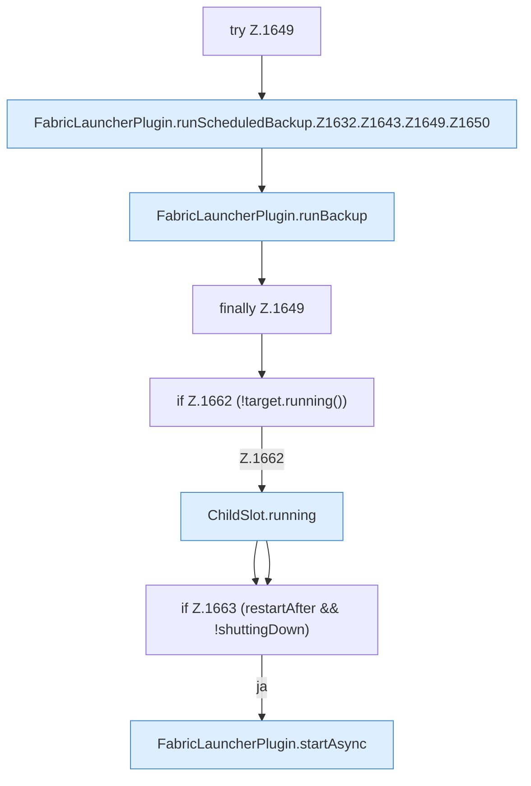

[[00 Start]] › [[Backup]] › [[Backup-Lauf]] › [[FabricLauncherPlugin.runScheduledBackup]] › [[FabricLauncherPlugin.runScheduledBackup.Z1632.Z1643.Z1649]]

# FabricLauncherPlugin.runScheduledBackup.Z1632.Z1643.Z1649

- Fortsetzung von `FabricLauncherPlugin.runScheduledBackup.Z1632.Z1643`, Quellreihenfolge.
