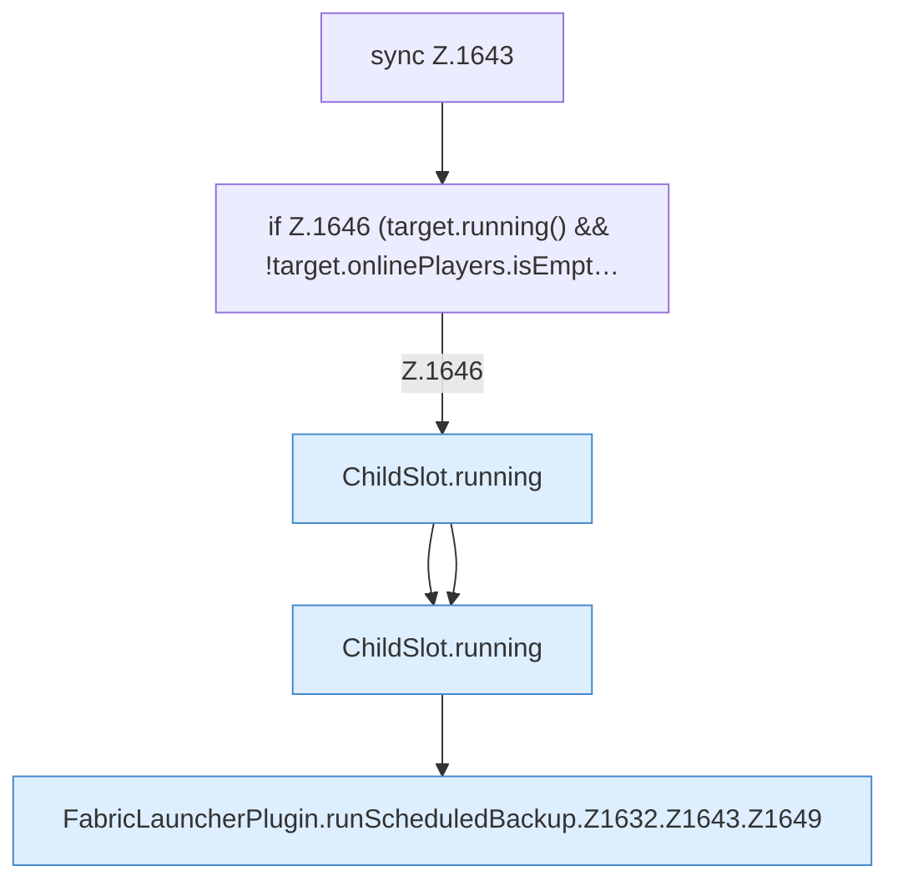

[[00 Start]] › [[Backup]] › [[Backup-Lauf]] › [[FabricLauncherPlugin.runScheduledBackup]] › [[FabricLauncherPlugin.runScheduledBackup.Z1632.Z1643]]

# FabricLauncherPlugin.runScheduledBackup.Z1632.Z1643

- Fortsetzung von `FabricLauncherPlugin.runScheduledBackup.Z1632`, Quellreihenfolge.
