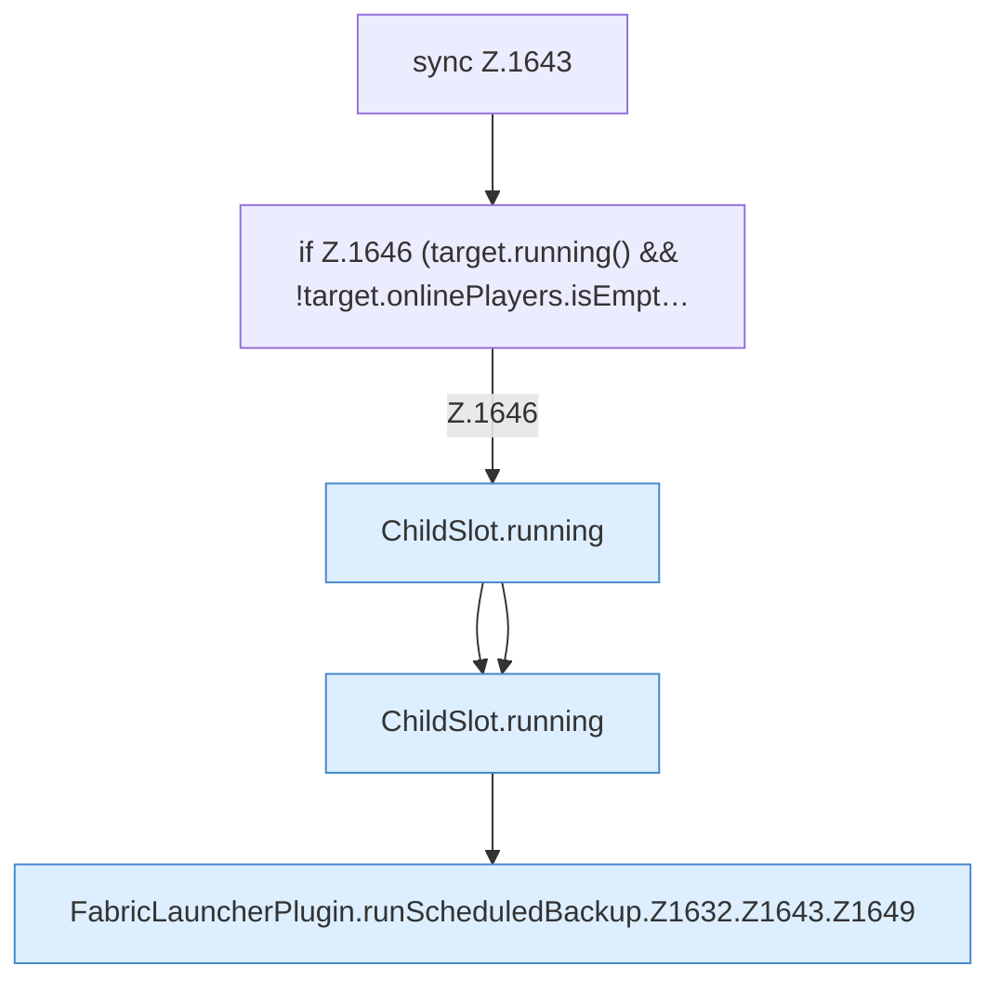

[[00 Start]] › [[Backup]] › [[Backup-Lauf]] › [[FabricLauncherPlugin.runScheduledBackup]] › [[FabricLauncherPlugin.runScheduledBackup.Z1632.Z1643]]

# FabricLauncherPlugin.runScheduledBackup.Z1632.Z1643



```knoten
sync Z.1643
  Zeile 1643: synchronisierter Block.
if Z.1646 (target.running() && !target.onlinePlayers.isEmpt…
  Zeile 1646: prüft `(target.running() && !target.onlinePlayers.isEmpt…`.
ChildSlot.running
  Dieser Teil prüft, ob läuft, das. Sagt, ob der [[Glossar#Prozess|Prozess]] läuft `running`.
FabricLauncherPlugin.runScheduledBackup.Z1632.Z1643.Z1649
  Der Ablauf geht in [[Glossar#Zeile|Zeile]] 1649 weiter. Eine Ebene tiefer steht er genauer. Fortsetzung des Ablaufs ab Zeile 1649.
```

> [!knoten]- Was die Blöcke tun
> - **sync Z.1643**: Zeile 1643: synchronisierter Block.
> - **if Z.1646 (target.running() && !target.onlinePlayers.isEmpt…**: Zeile 1646: prüft `(target.running() && !target.onlinePlayers.isEmpt…`.
> - **ChildSlot.running**: Dieser Teil prüft, ob läuft, das. Sagt, ob der [[Glossar#Prozess|Prozess]] läuft `running`.
> - **FabricLauncherPlugin.runScheduledBackup.Z1632.Z1643.Z1649**: Der Ablauf geht in [[Glossar#Zeile|Zeile]] 1649 weiter. Eine Ebene tiefer steht er genauer. Fortsetzung des Ablaufs ab Zeile 1649.

- Der Ablauf geht in [[Glossar#Zeile|Zeile]] 1643 weiter. Eine Ebene tiefer steht er genauer.
- Fortsetzung von `FabricLauncherPlugin.runScheduledBackup.Z1632`.
