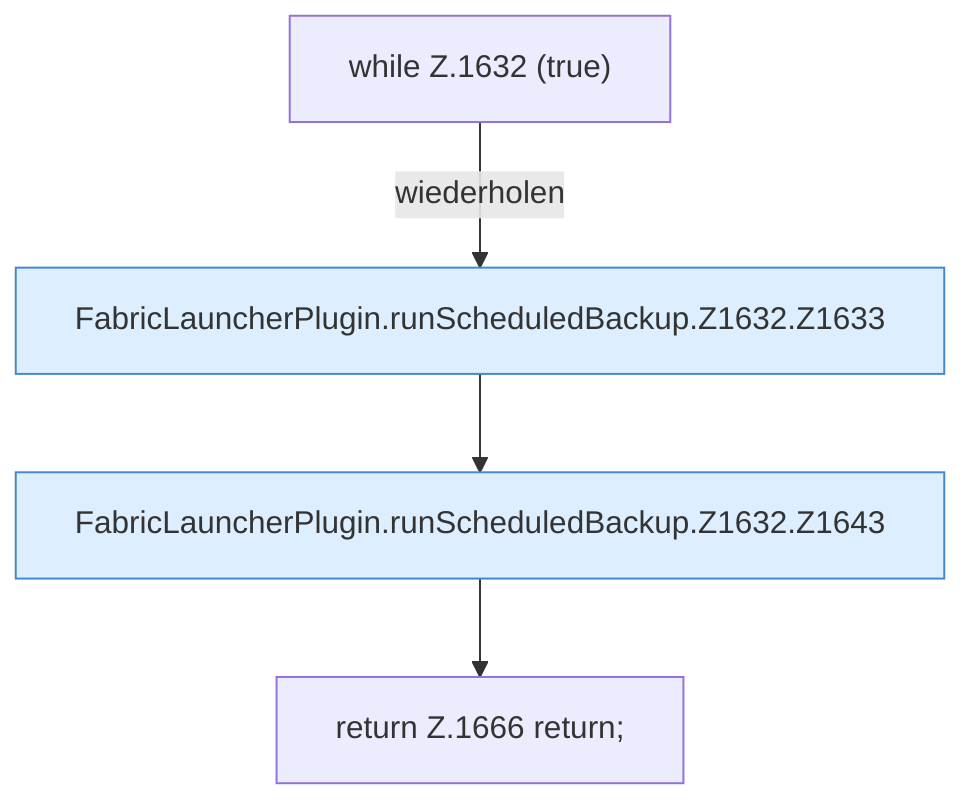

[[00 Start]] › [[Backup]] › [[Backup-Lauf]] › [[FabricLauncherPlugin.runScheduledBackup]] › [[FabricLauncherPlugin.runScheduledBackup.Z1632]]

# FabricLauncherPlugin.runScheduledBackup.Z1632



```knoten
while Z.1632 (true)
  Zeile 1632: Schleife `(true)`.
FabricLauncherPlugin.runScheduledBackup.Z1632.Z1633
  Fortsetzung des Ablaufs ab Zeile 1633.
FabricLauncherPlugin.runScheduledBackup.Z1632.Z1643
  Fortsetzung des Ablaufs ab Zeile 1643.
return Z.1666 return;
  Zeile 1666: Rückgabe `return;`.
```

- Fortsetzung von `FabricLauncherPlugin.runScheduledBackup`, Quellreihenfolge.
