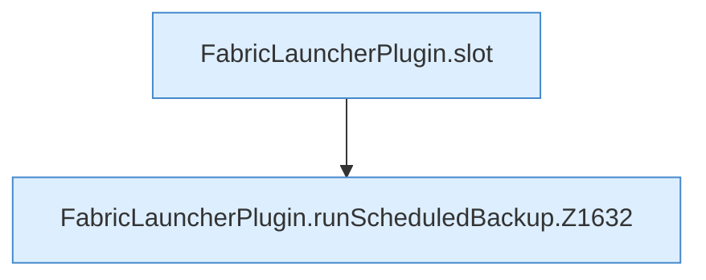

[[00 Start]] › [[Backup]] › [[Backup-Lauf]] › [[FabricLauncherPlugin.runScheduledBackup]]

# FabricLauncherPlugin.runScheduledBackup

`FabricLauncherPlugin.runScheduledBackup(TaskDef task, String id)` [src/main/java/de/aichele/childlauncher/FabricLauncherPlugin.java:1629–1668](https://github.com/Sciddie/minecraft-serverhoster-plugin/blob/95b02b953b0b4c23673e900e021a7c3c844aa37d/src/main/java/de/aichele/childlauncher/FabricLauncherPlugin.java#L1629-L1668)



```knoten
FabricLauncherPlugin.slot
  Das [[Glossar#Plugin|Plugin]] macht hier einen einzelnen Schritt. Eine Ebene tiefer steht er genauer. Im [[Glossar#Quelltext|Quelltext]] heißt das `slot`.
FabricLauncherPlugin.runScheduledBackup.Z1632
  Der Ablauf geht in [[Glossar#Zeile|Zeile]] 1632 weiter. Eine Ebene tiefer steht er genauer. Im [[Glossar#Quelltext|Quelltext]] heißt das `Z1632`.
```

> [!knoten]- Was die Blöcke tun
> - **FabricLauncherPlugin.slot**: Das [[Glossar#Plugin|Plugin]] macht hier einen einzelnen Schritt. Eine Ebene tiefer steht er genauer. Im [[Glossar#Quelltext|Quelltext]] heißt das `slot`.
> - **FabricLauncherPlugin.runScheduledBackup.Z1632**: Der Ablauf geht in [[Glossar#Zeile|Zeile]] 1632 weiter. Eine Ebene tiefer steht er genauer. Im [[Glossar#Quelltext|Quelltext]] heißt das `Z1632`.

- Das [[Glossar#Plugin|Plugin]] führt aus zur geplanten Zeit die [[Glossar#Sicherungskopie|Sicherungskopie]].
