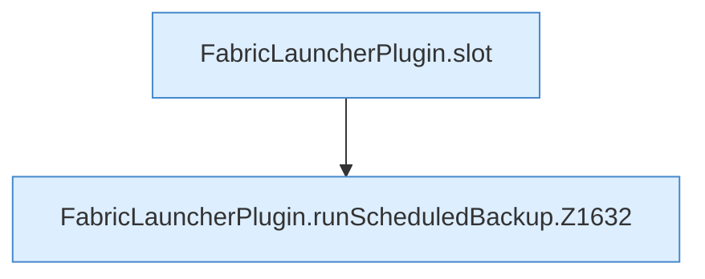

[[00 Start]] › [[Backup]] › [[Backup-Lauf]] › [[FabricLauncherPlugin.runScheduledBackup]]

# FabricLauncherPlugin.runScheduledBackup

`FabricLauncherPlugin.runScheduledBackup(TaskDef task, String id)` [src/main/java/de/aichele/childlauncher/FabricLauncherPlugin.java:1629–1668](https://github.com/Sciddie/minecraft-serverhoster-plugin/blob/95b02b953b0b4c23673e900e021a7c3c844aa37d/src/main/java/de/aichele/childlauncher/FabricLauncherPlugin.java#L1629-L1668)



```knoten
FabricLauncherPlugin.slot
  `slot` in `FabricLauncherPlugin.java`. Ruft `profile`, `ChildSlot`.
FabricLauncherPlugin.runScheduledBackup.Z1632
  Fortsetzung des Ablaufs ab Zeile 1632.
```

- `runScheduledBackup` in `src/main/java/de/aichele/childlauncher/FabricLauncherPlugin.java`
