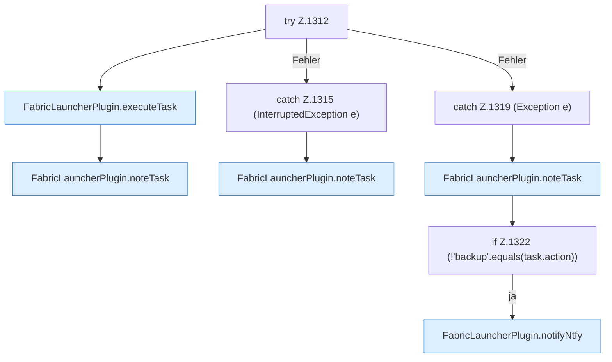

[[00 Start]] › [[Zeitplaene]] › [[Tasks]] › [[FabricLauncherPlugin.runTask]] › [[FabricLauncherPlugin.runTask.Z1312]]

# FabricLauncherPlugin.runTask.Z1312

- Fortsetzung von `FabricLauncherPlugin.runTask`, Quellreihenfolge.
