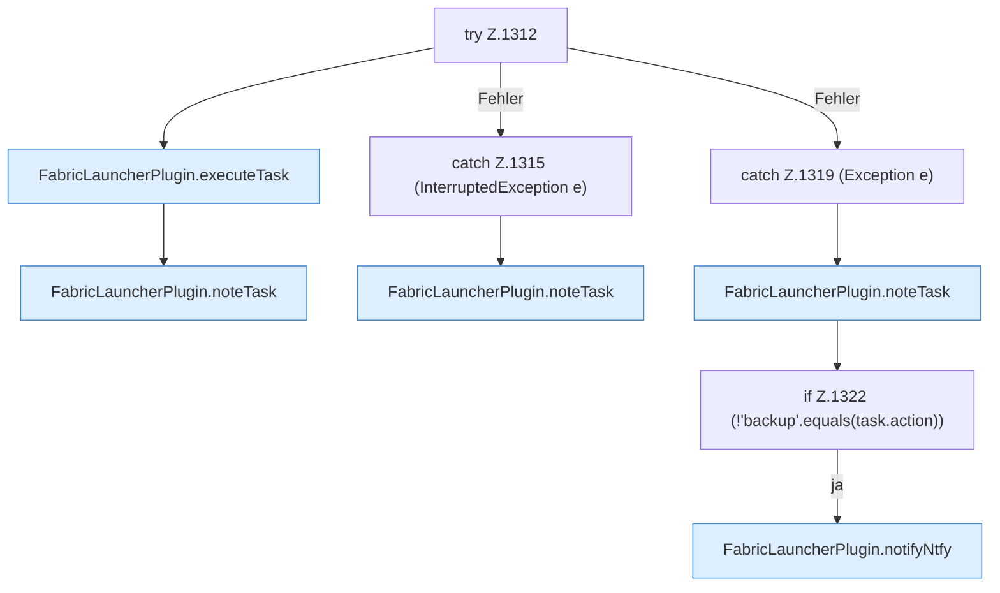

[[00 Start]] › [[Zeitplaene]] › [[Tasks]] › [[FabricLauncherPlugin.runTask]] › [[FabricLauncherPlugin.runTask.Z1312]]

# FabricLauncherPlugin.runTask.Z1312



```knoten
try Z.1312
  Zeile 1312: Versuch. Der Fehlerpfad geht in catch.
FabricLauncherPlugin.executeTask
  Das [[Glossar#Plugin|Plugin]] führt aus die [[Glossar#Aufgabe|Aufgabe]]. Führt aus `executeTask`. Ruft `startAsync`, `slot`, `stopBlocking`.
FabricLauncherPlugin.noteTask
  Schreibt auf, dass eine [[Glossar#Aufgabe|Aufgabe]] gelaufen ist. Merkt `noteTask`.
catch Z.1315 (InterruptedException e)
  Zeile 1315: fängt (InterruptedException e).
catch Z.1319 (Exception e)
  Zeile 1319: fängt (Exception e).
if Z.1322 (!'backup'.equals(task.action))
  Zeile 1322: prüft `(!'backup'.equals(task.action))`.
FabricLauncherPlugin.notifyNtfy
  Das [[Glossar#Plugin|Plugin]] meldet den Mitteilungsdienst. Meldet `notifyNtfy`. Ruft `ntfySettings`, `backupCredentials`, `send`.
```

> [!knoten]- Was die Blöcke tun
> - **try Z.1312**: Zeile 1312: Versuch. Der Fehlerpfad geht in catch.
> - **FabricLauncherPlugin.executeTask**: Das [[Glossar#Plugin|Plugin]] führt aus die [[Glossar#Aufgabe|Aufgabe]]. Führt aus `executeTask`. Ruft `startAsync`, `slot`, `stopBlocking`.
> - **FabricLauncherPlugin.noteTask**: Schreibt auf, dass eine [[Glossar#Aufgabe|Aufgabe]] gelaufen ist. Merkt `noteTask`.
> - **catch Z.1315 (InterruptedException e)**: Zeile 1315: fängt (InterruptedException e).
> - **catch Z.1319 (Exception e)**: Zeile 1319: fängt (Exception e).
> - **if Z.1322 (!'backup'.equals(task.action))**: Zeile 1322: prüft `(!'backup'.equals(task.action))`.
> - **FabricLauncherPlugin.notifyNtfy**: Das [[Glossar#Plugin|Plugin]] meldet den Mitteilungsdienst. Meldet `notifyNtfy`. Ruft `ntfySettings`, `backupCredentials`, `send`.

- Der Ablauf geht in [[Glossar#Zeile|Zeile]] 1312 weiter. Eine Ebene tiefer steht er genauer.
- Fortsetzung von `FabricLauncherPlugin.runTask`.
