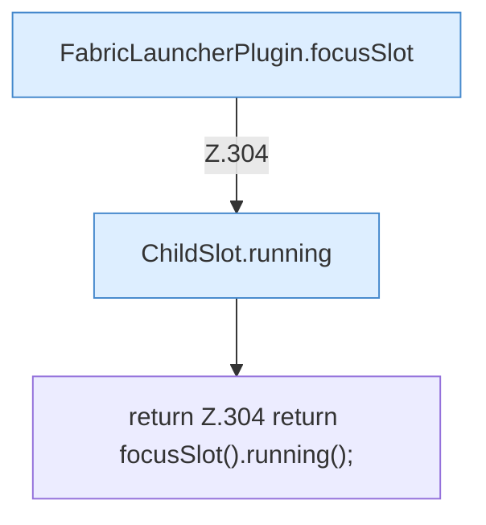

[[00 Start]] › [[Plugin-Kern]] › [[Slot-Status]] › [[FabricLauncherPlugin.running()]]

# FabricLauncherPlugin.running()

`FabricLauncherPlugin.running()` [src/main/java/de/aichele/childlauncher/FabricLauncherPlugin.java:304–304](https://github.com/Sciddie/minecraft-serverhoster-plugin/blob/95b02b953b0b4c23673e900e021a7c3c844aa37d/src/main/java/de/aichele/childlauncher/FabricLauncherPlugin.java#L304-L304)

- `running` in `src/main/java/de/aichele/childlauncher/FabricLauncherPlugin.java`
- Befund: toter Code, prüfen. src/main/java/de/aichele/childlauncher/FabricLauncherPlugin.java:304–304 kein Produktionsaufruf im Aufrufgraph; Name kommt in UI, Config oder anderem Text vor
