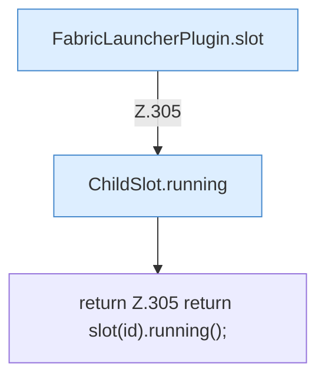

[[00 Start]] › [[Plugin-Kern]] › [[Slot-Status]] › [[FabricLauncherPlugin.running(String)]]

# FabricLauncherPlugin.running(String)

`FabricLauncherPlugin.running(String id)` [src/main/java/de/aichele/childlauncher/FabricLauncherPlugin.java:305–305](https://github.com/Sciddie/minecraft-serverhoster-plugin/blob/95b02b953b0b4c23673e900e021a7c3c844aa37d/src/main/java/de/aichele/childlauncher/FabricLauncherPlugin.java#L305-L305)



```knoten
FabricLauncherPlugin.slot
  Das [[Glossar#Plugin|Plugin]] macht hier einen einzelnen Schritt. Eine Ebene tiefer steht er genauer. Im [[Glossar#Quelltext|Quelltext]] heißt das `slot`.
ChildSlot.running
  Dieser Teil prüft, ob läuft, das. Im [[Glossar#Quelltext|Quelltext]] heißt das `running`.
return Z.305 return slot(id).running();
  Hier endet die [[Glossar#Funktion|Funktion]] und liefert ein Ergebnis zurück. Das steht in [[Glossar#Zeile|Zeile]] 305.
```

> [!knoten]- Was die Blöcke tun
> - **FabricLauncherPlugin.slot**: Das [[Glossar#Plugin|Plugin]] macht hier einen einzelnen Schritt. Eine Ebene tiefer steht er genauer. Im [[Glossar#Quelltext|Quelltext]] heißt das `slot`.
> - **ChildSlot.running**: Dieser Teil prüft, ob läuft, das. Im [[Glossar#Quelltext|Quelltext]] heißt das `running`.
> - **return Z.305 return slot(id).running();**: Hier endet die [[Glossar#Funktion|Funktion]] und liefert ein Ergebnis zurück. Das steht in [[Glossar#Zeile|Zeile]] 305.

- Sagt, ob der [[Glossar#Spielserver|Spielserver]] gerade läuft.
- Auffällig: im normalen Betrieb ruft das niemand auf. Das nennt man [[Glossar#Ungenutzt|Ungenutzt]].
