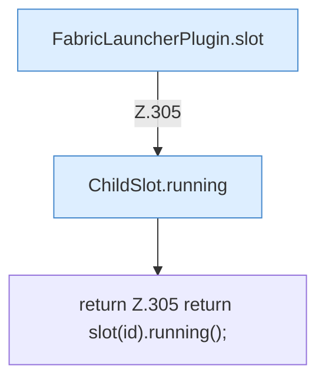

[[00 Start]] › [[Plugin-Kern]] › [[Slot-Status]] › [[FabricLauncherPlugin.running(String)]]

# FabricLauncherPlugin.running(String)

`FabricLauncherPlugin.running(String id)` [src/main/java/de/aichele/childlauncher/FabricLauncherPlugin.java:305–305](https://github.com/Sciddie/minecraft-serverhoster-plugin/blob/95b02b953b0b4c23673e900e021a7c3c844aa37d/src/main/java/de/aichele/childlauncher/FabricLauncherPlugin.java#L305-L305)



```knoten
FabricLauncherPlugin.slot
  `slot` in `FabricLauncherPlugin.java`. Ruft `profile`, `ChildSlot`.
ChildSlot.running
  Sagt, ob der Prozess läuft `running`.
return Z.305 return slot(id).running();
  Zeile 305: Rückgabe `return slot(id).running();`.
```

- `running` in `src/main/java/de/aichele/childlauncher/FabricLauncherPlugin.java`
- Befund: toter Code, prüfen. src/main/java/de/aichele/childlauncher/FabricLauncherPlugin.java:305–305 kein Produktionsaufruf im Aufrufgraph; Name kommt in UI, Config oder anderem Text vor
