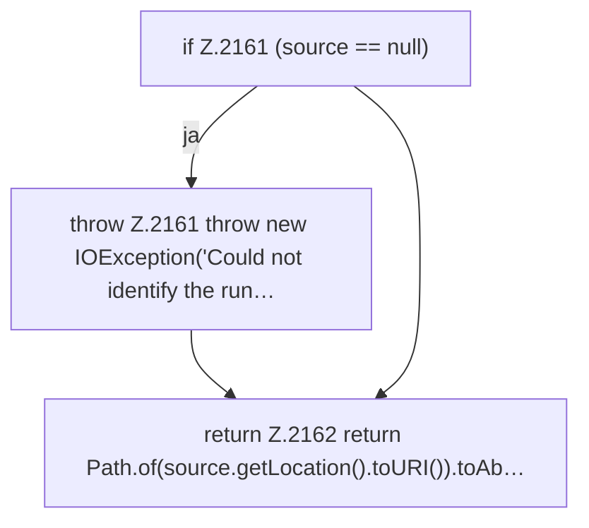

[[00 Start]] › [[Plugin-Kern]] › [[Host-Pfade]] › [[FabricLauncherPlugin.runningPluginJar]]

# FabricLauncherPlugin.runningPluginJar

`FabricLauncherPlugin.runningPluginJar()` [src/main/java/de/aichele/childlauncher/FabricLauncherPlugin.java:2159–2163](https://github.com/Sciddie/minecraft-serverhoster-plugin/blob/95b02b953b0b4c23673e900e021a7c3c844aa37d/src/main/java/de/aichele/childlauncher/FabricLauncherPlugin.java#L2159-L2163)



```knoten
if Z.2161 (source == null)
  Zeile 2161: prüft `(source == null)`.
throw Z.2161 throw new IOException('Could not identify the run…
  Zeile 2161: Abbruch `throw new IOException('Could not identify the run…`.
return Z.2162 return Path.of(source.getLocation().toURI()).toAb…
  Zeile 2162: Rückgabe `return Path.of(source.getLocation().toURI()).toAb…`.
```

- `runningPluginJar` in `src/main/java/de/aichele/childlauncher/FabricLauncherPlugin.java`
