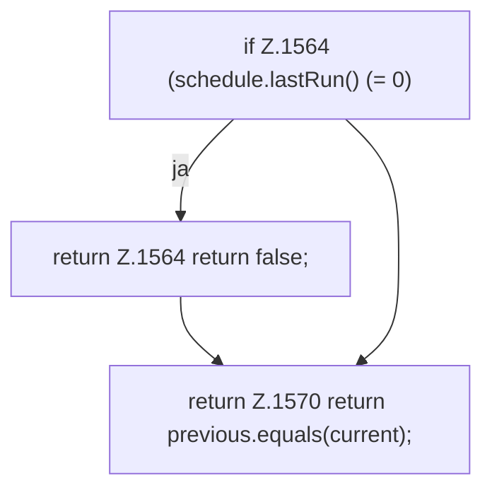

[[00 Start]] › [[Zeitplaene]] › [[Schedules]] › [[FabricLauncherPlugin.sameScheduleMinute]]

# FabricLauncherPlugin.sameScheduleMinute

`FabricLauncherPlugin.sameScheduleMinute(ScheduleDef schedule, long timestamp)` [src/main/java/de/aichele/childlauncher/FabricLauncherPlugin.java:1563–1571](https://github.com/Sciddie/minecraft-serverhoster-plugin/blob/95b02b953b0b4c23673e900e021a7c3c844aa37d/src/main/java/de/aichele/childlauncher/FabricLauncherPlugin.java#L1563-L1571)



```knoten
if Z.1564 (schedule.lastRun() (= 0)
  Hier fällt eine Entscheidung. Nur wenn sie zutrifft, geht es den Ja-Weg weiter. Das steht in [[Glossar#Zeile|Zeile]] 1564.
return Z.1564 return false;
  Hier endet die [[Glossar#Funktion|Funktion]] und liefert ein Ergebnis zurück. Das steht in [[Glossar#Zeile|Zeile]] 1564.
return Z.1570 return previous.equals(current);
  Hier endet die [[Glossar#Funktion|Funktion]] und liefert ein Ergebnis zurück. Das steht in [[Glossar#Zeile|Zeile]] 1570.
```

> [!knoten]- Was die Blöcke tun
> - **if Z.1564 (schedule.lastRun() (= 0)**: Hier fällt eine Entscheidung. Nur wenn sie zutrifft, geht es den Ja-Weg weiter. Das steht in [[Glossar#Zeile|Zeile]] 1564.
> - **return Z.1564 return false;**: Hier endet die [[Glossar#Funktion|Funktion]] und liefert ein Ergebnis zurück. Das steht in [[Glossar#Zeile|Zeile]] 1564.
> - **return Z.1570 return previous.equals(current);**: Hier endet die [[Glossar#Funktion|Funktion]] und liefert ein Ergebnis zurück. Das steht in [[Glossar#Zeile|Zeile]] 1570.

- Das [[Glossar#Plugin|Plugin]] plant Zeitpunkt.
