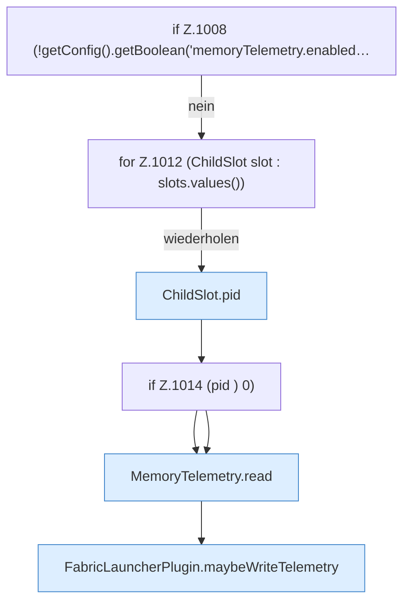

[[00 Start]] › [[Host-Betrieb]] › [[Speicher-Probe]] › [[FabricLauncherPlugin.sampleHostMemory]] › [[FabricLauncherPlugin.sampleHostMemory.Teil1.Z1008]]

# FabricLauncherPlugin.sampleHostMemory.Teil1.Z1008



```knoten
if Z.1008 (!getConfig().getBoolean('memoryTelemetry.enabled…
  Zeile 1008: prüft `(!getConfig().getBoolean('memoryTelemetry.enabled…`.
for Z.1012 (ChildSlot slot : slots.values())
  Zeile 1012: Schleife `(ChildSlot slot : slots.values())`.
ChildSlot.pid
  Liefert die Prozessnummer `pid`.
if Z.1014 (pid ) 0)
  Zeile 1014: prüft `(pid ) 0)`.
MemoryTelemetry.read
  Liest `read`. Ruft `snapshot`, `number`, `current`.
FabricLauncherPlugin.maybeWriteTelemetry
  Führt nur aus, wenn die Sperrzeit um ist `maybeWriteTelemetry`. Ruft `boundedSeconds`, `warnOnce`, `line`.
```

- Fortsetzung von `FabricLauncherPlugin.sampleHostMemory.Teil1`, Quellreihenfolge.
