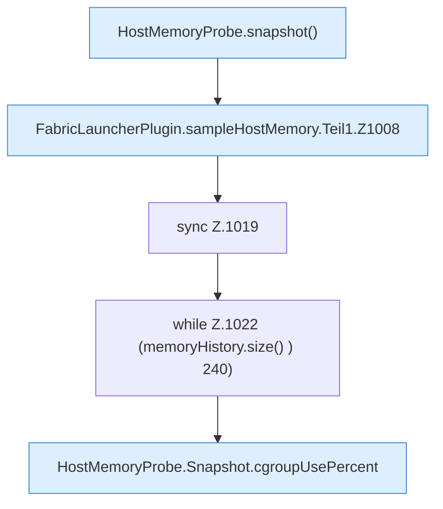

[[00 Start]] › [[Host-Betrieb]] › [[Speicher-Probe]] › [[FabricLauncherPlugin.sampleHostMemory]] › [[FabricLauncherPlugin.sampleHostMemory.Teil1]]

# FabricLauncherPlugin.sampleHostMemory.Teil1



```knoten
HostMemoryProbe.snapshot()
  Die Messung macht hier einen einzelnen Schritt. Eine Ebene tiefer steht er genauer. `snapshot` in `HostMemoryProbe.java`. Ruft `snapshot`.
FabricLauncherPlugin.sampleHostMemory.Teil1.Z1008
  Der Ablauf geht in [[Glossar#Zeile|Zeile]] 1008 weiter. Eine Ebene tiefer steht er genauer. Fortsetzung des Ablaufs ab Zeile 1008.
sync Z.1019
  Zeile 1019: synchronisierter Block.
while Z.1022 (memoryHistory.size() ) 240)
  Zeile 1022: Schleife `(memoryHistory.size() ) 240)`.
HostMemoryProbe.Snapshot.cgroupUsePercent
  Die Messung macht hier einen einzelnen Schritt. Eine Ebene tiefer steht er genauer. `cgroupUsePercent` in `HostMemoryProbe.java`.
```

> [!knoten]- Was die Blöcke tun
> - **HostMemoryProbe.snapshot()**: Die Messung macht hier einen einzelnen Schritt. Eine Ebene tiefer steht er genauer. `snapshot` in `HostMemoryProbe.java`. Ruft `snapshot`.
> - **FabricLauncherPlugin.sampleHostMemory.Teil1.Z1008**: Der Ablauf geht in [[Glossar#Zeile|Zeile]] 1008 weiter. Eine Ebene tiefer steht er genauer. Fortsetzung des Ablaufs ab Zeile 1008.
> - **sync Z.1019**: Zeile 1019: synchronisierter Block.
> - **while Z.1022 (memoryHistory.size() ) 240)**: Zeile 1022: Schleife `(memoryHistory.size() ) 240)`.
> - **HostMemoryProbe.Snapshot.cgroupUsePercent**: Die Messung macht hier einen einzelnen Schritt. Eine Ebene tiefer steht er genauer. `cgroupUsePercent` in `HostMemoryProbe.java`.

- Ein weiterer Abschnitt derselben Übersicht.
- Fortsetzung von `FabricLauncherPlugin.sampleHostMemory`.
