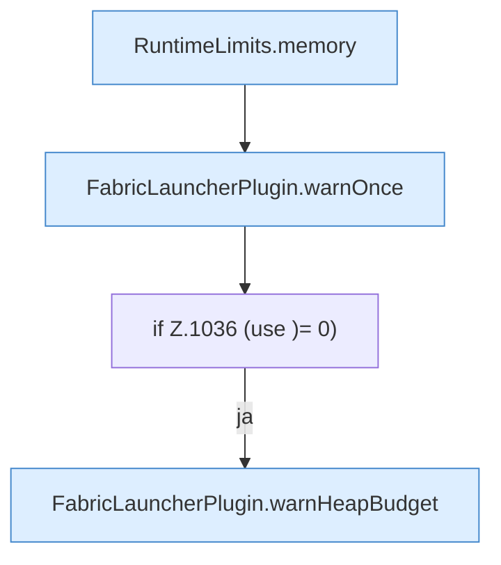

[[00 Start]] › [[Host-Betrieb]] › [[Speicher-Probe]] › [[FabricLauncherPlugin.sampleHostMemory]] › [[FabricLauncherPlugin.sampleHostMemory.Teil2]]

# FabricLauncherPlugin.sampleHostMemory.Teil2



```knoten
RuntimeLimits.memory
  Betrifft den Speicher `memory`. Ruft `percent`.
FabricLauncherPlugin.warnOnce
  Warnt `warnOnce`.
if Z.1036 (use )= 0)
  Zeile 1036: prüft `(use )= 0)`.
FabricLauncherPlugin.warnHeapBudget
  Warnt `warnHeapBudget`. Ruft `parseMemoryBytes`, `notifyNtfy`.
```

- Fortsetzung von `FabricLauncherPlugin.sampleHostMemory`, Quellreihenfolge.
